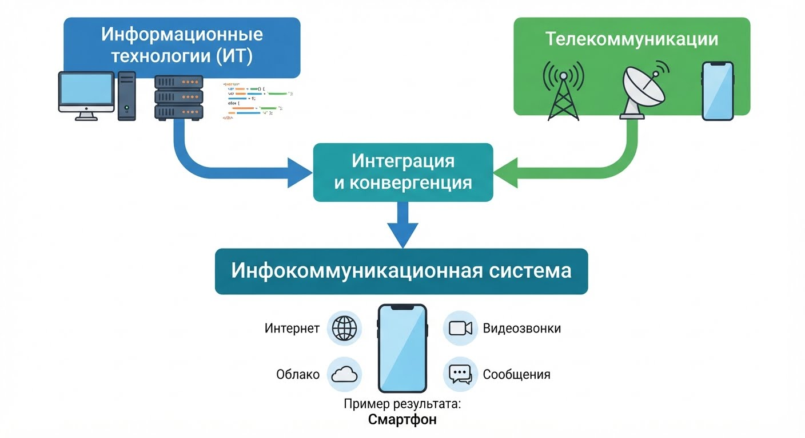
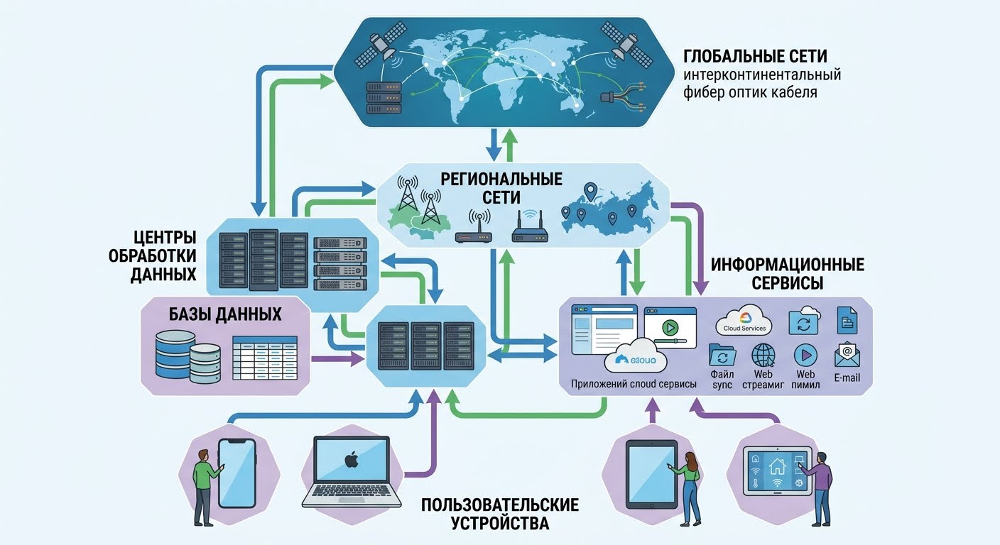
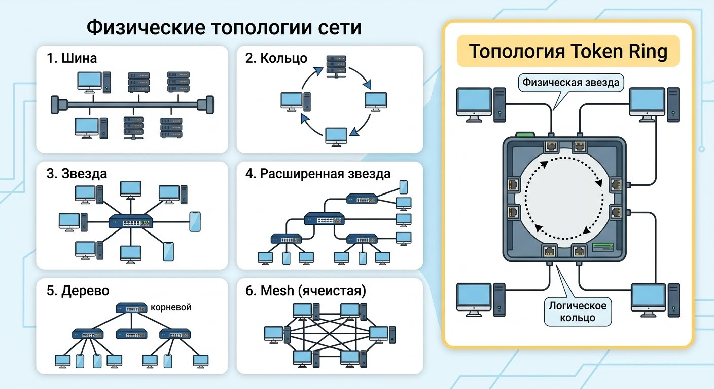
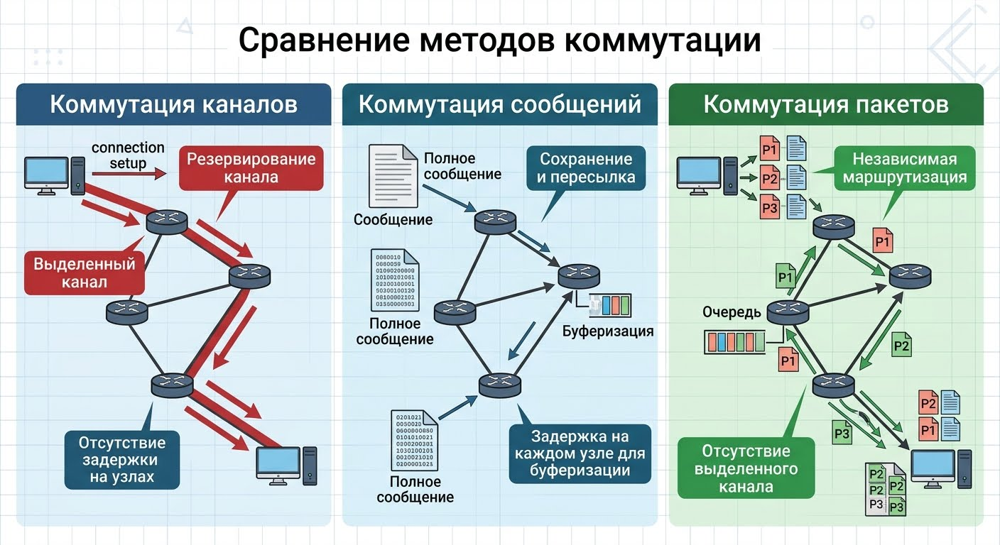
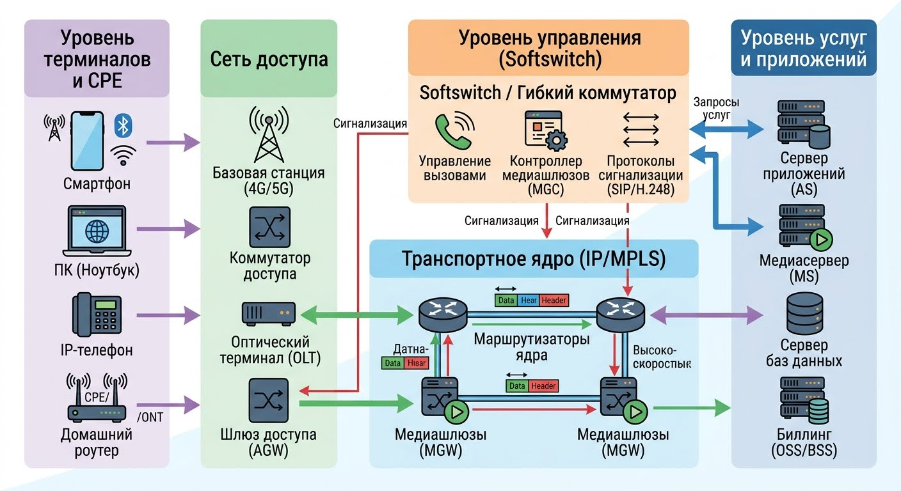
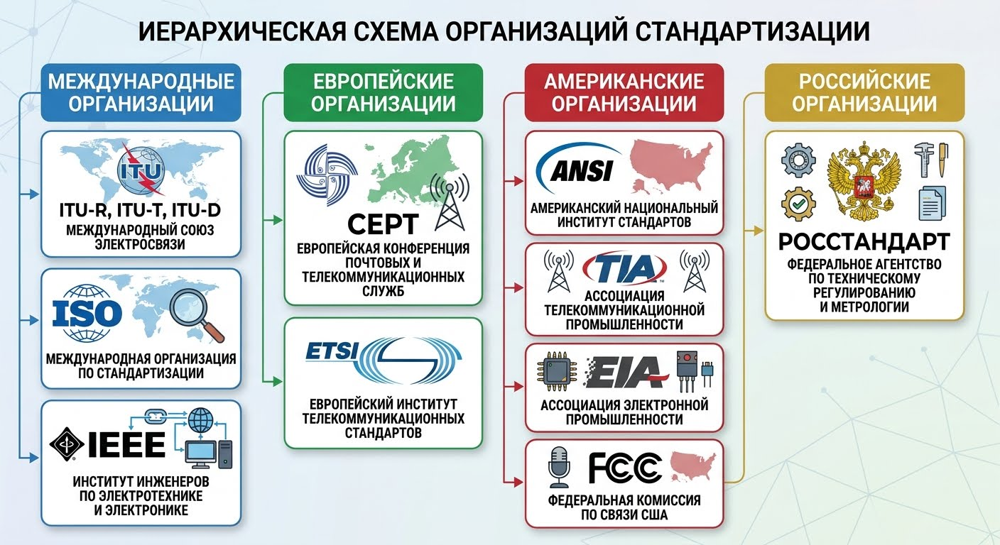

# Основы инфокоммуникационных систем

> Картинки в данном материале сделаные с использованием искусственного интеллекта. Они могут содержать неточечную информацию, но задачу визуализации выполняют успешно.

## Блок 1. Базовые понятия и компоненты

### Почему информационные технологии и телекоммуникации объединились?

Современное общество невозможно представить без постоянного обмена информацией. Телефонная связь, Интернет, телевидение, корпоративные системы и облачные платформы требуют не только передачи данных, но и их обработки, хранения и предоставления пользователям. Исторически эти задачи решались двумя самостоятельными направлениями. **Телекоммуникационные технологии** развивались вокруг телефонных, телеграфных, радиосистем и линий связи, обеспечивая передачу информации на расстояние. **Вычислительная техника**, напротив, предназначалась для обработки и хранения данных.

Однако с распространением компьютеров возникла необходимость обмениваться информацией между территориально удалёнными вычислительными системами. Одновременно сами сети связи становились сложнее и нуждались в вычислительных средствах для управления соединениями и предоставления новых услуг. Решением стало объединение вычислительных и телекоммуникационных технологий в общую инфраструктуру. Этот процесс получил два названия: интеграция и конвергенция. **Интеграция** означает объединение отдельных технических и программных компонентов в единую систему, а **конвергенция** — сближение ранее самостоятельных технологий и услуг, которые постепенно начинают использовать общие решения.

Например, современный смартфон одновременно является вычислительным устройством, терминалом мобильной связи, средством доступа в Интернет и платформой для видеоконференций. Все эти функции работают благодаря взаимодействию вычислительной техники, программного обеспечения и телекоммуникационной инфраструктуры. Таким образом, необходимость одновременно обрабатывать информацию и передавать её на большие расстояния привела к формированию **инфокоммуникаций** — области технологий, объединяющей информационные и телекоммуникационные средства.

### Инфокоммуникационная система и её составляющие

Объединение вычислительных и телекоммуникационных средств потребовало новой модели, которая описывала бы не только передачу данных, но и весь процесс работы с информацией.

**Инфокоммуникационная система** — совокупность информационных и телекоммуникационных средств, обеспечивающих создание, обработку, хранение, передачу и получение информации конечными пользователями. В её составе выделяют три взаимосвязанные подсистемы:

1. **Телекоммуникационная подсистема** отвечает за передачу информации от источника к получателю.
2. **Прикладная подсистема** обеспечивает обработку и хранение данных, работу программных комплексов и приложений.
3. **Пользовательская подсистема** включает людей, организации и оконечные устройства, с помощью которых создаётся и используется информация.

Необходимость совместной работы этих подсистем легко проследить на примере корпоративной информационной системы. Когда сотрудник открывает приложение и запрашивает сведения из базы данных, его компьютер выступает пользовательским компонентом. Приложение обрабатывает запрос, сервер предоставляет необходимые сведения, а телекоммуникационная сеть доставляет запрос и результат между устройствами. Без любой из этих составляющих полноценная работа системы невозможна. При этом важно различать два вида процессов. **Информационные процессы** включают сбор, обработку, накопление, хранение, поиск и распространение данных. **Телекоммуникационные процессы** обеспечивают их передачу между территориально распределёнными участниками. Инфокоммуникационная система объединяет оба направления, поэтому обработка и передача информации рассматриваются в ней как единый процесс. С этим связаны несколько близких понятий:

| Понятие | Содержание |
| :-- | :-- |
| **Инфокоммуникация** | Совокупность средств обработки, накопления, хранения и передачи информации, объединённых в единую сетевую среду |
| **Инфокоммуникационная сеть** | Совокупность территориально распределённых информационных и вычислительных ресурсов, программных комплексов управления и средств телекоммуникации |
| **Инфокоммуникационные технологии** | Методы обработки, хранения, отображения, обеспечения целостности и передачи информации с требуемым качеством |
| **Инфокоммуникационные услуги** | Сервисы, удовлетворяющие информационные, телекоммуникационные или одновременно оба вида потребностей пользователя |

Особенность инфокоммуникационных услуг заключается в том, что пользователь может непосредственно управлять их предоставлением: выбирать источник информации, менять параметры соединения и настраивать приложение.

Также, в технической литературе также встречаются понятия **информационно-телекоммуникационная система** и **информационно-телекоммуникационная сеть**. Первое акцентирует внимание на технологических процессах сбора, обработки, хранения, поиска информации, доступа к ней и переноса сообщений. Второе описывает технологическую инфраструктуру из линий связи, узлов и пользовательского оборудования, обеспечивающую доставку информации и её временное хранение в процессе передачи. В российском законодательстве для информационно-телекоммуникационной сети существует отдельное определение. Поэтому близкие термины не всегда можно считать полностью взаимозаменяемыми.

### Глобальная информационная инфраструктура

Объединение вычислительных систем и телекоммуникационных сетей позволило перейти от отдельных локальных ресурсов к глобальной среде, в которой информация может храниться и обрабатываться в разных частях мира. Для описания такой модели используется понятие **Глобальной информационной инфраструктуры (ГИИ)**. Её основная задача заключается в обеспечении доступа пользователей к распределённым информационным ресурсам независимо от их физического расположения. Для этого объединяются глобальные и региональные сети, вычислительные центры, серверы, базы данных, системы обработки информации, программные платформы и пользовательские терминалы. Интернет является наиболее известной практической основой такой инфраструктуры. Однако ГИИ шире самого Интернета: она предполагает не только передачу данных, но и распределённую обработку, хранение информации, управление ресурсами и взаимодействие различных информационных систем. Таким образом, ГИИ представляет собой обобщённую модель глобальной информационной среды, существование которой стало возможным благодаря интеграции вычислительных и телекоммуникационных технологий.

### Компоннеты инфокоммуникационных систем

Для выполнения перечисленных функций необходимы аппаратные и программные компоненты. В первую очередь используются **компьютеры и серверы**, которые обрабатывают информацию, выполняют приложения и хранят данные. В зависимости от назначения компьютер может быть пользовательской рабочей станцией, сервером приложений, системой хранения или специализированным вычислительным узлом.

Для взаимодействия с системой пользователям необходимы **терминалы** — устройства ввода, получения и передачи информации. К ним относятся персональные компьютеры, смартфоны, телефонные аппараты и специализированное оборудование.

Связь между устройствами обеспечивают **каналы связи**. В качестве среды передачи могут использоваться медные телефонные линии, коаксиальные кабели, оптоволокно и беспроводные радиоканалы. Выбор конкретного варианта определяется необходимой скоростью, расстоянием, условиями эксплуатации и стоимостью.

Однако для непосредственной передачи данных недостаточно только физической линии. Требуются специальные **процессоры связи (Communication Processors)** — устройства, обеспечивающие приём, передачу и преобразование сигналов. К ним относятся модемы, мультиплексоры, контроллеры и другие коммуникационные устройства.

Наконец, все компоненты должны работать согласованно. Эту задачу выполняет **программное обеспечение**, которое управляет оборудованием, организует сетевой обмен, обрабатывает сетевые операции и реализует механизмы взаимодействия между устройствами.

Таким образом, инфокоммуникационная система представляет собой сочетание вычислительных устройств, пользовательских терминалов, каналов передачи, коммуникационного оборудования и программных средств.

### Пользователи, оконечные системы и распределённые ресурсы

Поскольку главная задача инфокоммуникационной сети заключается в предоставлении информационных услуг, её работа начинается с пользовательского запроса. Пользователями могут быть физические лица, предприятия, организации и другие информационные системы.

Когда пользователь обращается к сервису, в его **оконечной системе** запускается прикладной процесс, который формирует запрос, передаёт его по сети и принимает ответ. Например, браузер запрашивает веб-страницу, почтовое приложение взаимодействует с почтовым сервером, а телефон инициирует процедуру установления соединения. По выполняемым функциям оконечные системы можно разделить на три группы.

| Тип системы | Назначение | Примеры |
| :-- | :-- | :-- |
| **Терминальные** | Обеспечивают доступ пользователей к сети и её ресурсам | Компьютеры, смартфоны, телефоны |
| **Рабочие** | Предоставляют сетевые ресурсы и сервисы | Серверы файлов, приложений, базы данных, системы обслуживания вызовов |
| **Административные** | Обеспечивают управление сетью и её отдельными участками | Системы мониторинга, управления конфигурацией и доступом |

Все эти устройства могут находиться в разных зданиях и городах. Поэтому центральным связующим компонентом системы является **телекоммуникационная сеть**, которая обеспечивает взаимодействие территориально распределённых пользователей, приложений и вычислительных ресурсов.

## Блок 2. Сетевая инфраструктура и архитектура

### Компьютерные сети и телекоммуникационная инфраструктура

Когда компьютеры перестали использоваться исключительно автономно, возникла необходимость объединять их для обмена данными и совместной работы с ресурсами. Так появились **компьютерные сети** — совокупности компьютеров и телекоммуникационного оборудования, обеспечивающие информационный обмен. Благодаря сетям пользователь может обращаться к файлам, базам данных, приложениям, вычислительным мощностям и периферийным устройствам, даже если они находятся на удалённом сервере.

Для организации такого взаимодействия используется телекоммуникационная инфраструктура. Сам термин «телекоммуникации» образован от греческого *tele* — «далеко» и латинского *communicatio* — «общение». В широком смысле **телекоммуникации** — это передача и приём информации на расстояние с помощью электромагнитных систем и каналов связи. Передаваться могут речь, звук, изображения, видео, текст и цифровые данные. Для этого применяются проводные, оптические и беспроводные среды. В зависимости от передаваемой информации и назначения сети выделяют компьютерные, телефонные, радиосети и телевизионные сети. Несмотря на различия в техническом устройстве, все они решают общую задачу — обеспечивают обмен информацией между территориально распределёнными участниками.

### Классификация сетей по масштабу и назначению

По мере роста числа подключённых устройств сети начали охватывать всё большие территории. Для их описания используется классификация по географическому масштабу.

| Тип сети | Территория | Назначение и особенности |
| :-- | :-- | :-- |
| **LAN (Local Area Network)** | Помещение, здание, предприятие или кампус | Объединяет устройства одной организации, обычно обеспечивает высокие скорости передачи |
| **MAN (Metropolitan Area Network)** | Район или город | Соединяет отдельные здания, организации и локальные сети |
| **WAN (Wide Area Network)** | Регионы, страны и континенты | Объединяет удалённые сети и обеспечивает передачу данных на большие расстояния |

Для локальных сетей характерно управление со стороны одной организации. Сетевой администратор отвечает за физические соединения, настройку активного оборудования, организацию общего доступа и стабильность работы. Внутри сети используются рабочие группы, а маршрутизация может быть статической или динамической, в зависимости от сложности инфраструктуры. Городские сети развивались не только как продолжение локальных сетей, но и на основе уже существовавших коммуникационных систем. Например, операторы кабельного телевидения обнаружили, что часть частотного спектра в кабельной инфраструктуре можно использовать для передачи цифровых данных. Это позволило приспособить существующие сети для предоставления доступа в Интернет. Другим примером городского беспроводного доступа стала технология IEEE 802.16, известная также как WiMAX. Для WAN, охватывающих большие расстояния, использование одной локальной технологии уже недостаточно. Поэтому применяются магистральные линии операторов и технологии транспортировки данных, среди которых TCP/IP, SONET/SDH, MPLS, ATM и Frame Relay. Историческим предшественником Frame Relay выступала технология X.25.

Помимо территории, сети классифицируют по нескольким независимым признакам:

| Признак | Варианты | Различие |
| :-- | :-- | :-- |
| Функциональное назначение | Вычислительные, информационные, смешанные | Обработка информации, предоставление данных или сочетание этих функций |
| Способ управления | Централизованные, децентрализованные, смешанные | Наличие центрального управляющего узла или распределение функций управления |
| Однородность | Однородные (гомогенные), неоднородные (гетерогенные) | Использование совместимого оборудования либо объединение различных архитектур и программных средств |

На практике крупные сети обычно неоднородны, поскольку объединяют оборудование разных производителей, операционные системы и сетевые протоколы.

### Иерархия магистральных и территориальных сетей

Классификация LAN, MAN и WAN описывает географический масштаб, но сама по себе не показывает, как организовано взаимодействие между сетями разного уровня. Для построения крупных инфраструктур используется территориальная иерархия. На верхнем уровне находятся **глобальные сети**, охватывающие значительные части мира. Примерами служат всемирная телефонная сеть общего пользования, Интернет, сотовые сети GSM и спутниковые системы, например Inmarsat. Ниже располагаются **национальные сети**, объединяющие телекоммуникационную инфраструктуру в пределах государства. Они включают магистральные транспортные сети, сети доступа и службы связи. В России примером такой инфраструктуры является сеть связи Российской Федерации, объединяющая взаимосвязанные региональные сети общего пользования и ведомственные сети. Частные и технологические сети отдельных организаций рассматриваются отдельно от этой модели. Для связи национальных магистралей с отдельными городами и населёнными пунктами используются **зоновые первичные сети**. Они имеют областное, краевое или республиканское значение и распределяют потоки между магистральными направлениями и местными сетями. На нижнем уровне располагаются **городские и сельские сети**, через которые подключаются конкретные абоненты.

Причина такой иерархии проста: прокладывать отдельную линию от каждого абонента до центрального узла слишком дорого и технически сложно. Поэтому на промежуточных уровнях размещаются сетевые узлы, которые собирают трафик и передают его дальше. Например, в городской телефонной сети Томска абоненты центральных районов могут подключаться непосредственно к телефонным станциям. Для удалённых микрорайонов прокладка отдельных линий от каждой квартиры до центральной станции была бы неэффективной. Вместо этого рядом с абонентами устанавливаются **выносные цифровые концентраторы**. Они собирают трафик от нескольких домов и могут замыкать некоторые соединения локально. Если же требуется связаться с абонентом другого района или города, информация передаётся по вышестоящим каналам к центральным узлам. Таким образом, иерархия позволяет экономить на линиях связи и оборудовании, рационально используя пропускную способность магистралей.

### Физическая и логическая топология сетей

После определения масштаба сети необходимо решить, каким образом будут соединяться её устройства. Для этого используется понятие **топологии**. **Физическая топология** описывает реальное расположение кабелей, портов, коммутаторов и других элементов. **Логическая топология** показывает, каким образом данные перемещаются между устройствами и по каким правилам организован обмен информацией. Эти схемы могут отличаться друг от друга. В локальных сетях исторически применялись несколько основных физических топологий.

| Топология | Принцип соединения | Особенности |
| :-- | :-- | :-- |
| **Шина (Bus)** | Все устройства подключены к общей линии | Простая организация, но общий канал является разделяемым ресурсом, поэтому необходимо управлять доступом к нему и предотвращать конфликты передачи |
| **Кольцо (Ring)** | Устройства соединены последовательно в замкнутую цепочку | Данные проходят через последовательность узлов; отказ отдельного участка может нарушить связь, если не предусмотрено резервирование |
| **Звезда (Star)** | Все устройства подключены к центральному узлу | Удобна для управления и диагностики, но отказ центра может затронуть всю сеть |
| **Расширенная звезда (Extended Star)** | Несколько звёзд соединены через вышестоящие устройства | Позволяет строить более крупные сети |
| **Дерево (Hierarchical)** | Нижестоящие устройства соединяются через промежуточные и верхние узлы | Обеспечивает иерархическое разделение сети на уровни |
| **Ячеистая сеть (Mesh)** | Между узлами существует множество соединений | Повышает отказоустойчивость, но требует большого числа линий и портов |

В полносвязной ячеистой сети каждый узел имеет прямое соединение с каждым другим узлом. Это позволяет передавать информацию по альтернативным каналам, если один из них выходит из строя. Однако количество необходимых соединений быстро увеличивается вместе с числом узлов, поэтому на практике чаще применяются частично ячеистые и комбинированные структуры.

Для описания территориально распределённых сетей используются сходные способы построения: полносвязный, радиальный, кольцевой, радиально-узловой и комбинированный.

| Способ построения | Принцип | Соответствие топологии |
| :-- | :-- | :-- |
| **Полносвязный** | Каждый узел непосредственно связан с остальными | Mesh |
| **Радиальный** | Все соединения проходят через центральный узел | Звезда |
| **Кольцевой** | Узлы образуют замкнутую последовательность | Кольцо |
| **Радиально-узловой** | Центральные и промежуточные узлы соединяются магистралями, к которым подключаются местные сети | Иерархическая комбинированная структура |
| **Комбинированный** | Объединяет несколько способов соединения | Сочетание разных топологий |

В реальных инфраструктурах редко используется только одна топология: на верхних уровнях могут применяться кольца или ячеистые соединения, а на нижних — экономичные радиальные схемы. Особенно важно не путать физическую и логическую организацию. Например, технология **Token Ring** физически могла строиться по схеме «звезда»: устройства подключались к центральному многопортовому оборудованию. Однако логически передача данных организовывалась в виде кольца. Поэтому форма кабельных соединений не всегда отражает реальный порядок передачи информации.

### Функциональная организация телекоммуникационных сетей

Территориальное разделение показывает, где расположены узлы сети, а топология — как они соединены. Но для понимания работы всей инфраструктуры необходимо также разделить её по выполняемым функциям. На базовом уровне находится **первичная сеть**, создающая и распределяющая каналы и тракты передачи информации. В неё входят системы передачи, сетевые узлы, обеспечивающие долговременные соединения, и сетевые станции, распределяющие каналы между вторичными сетями. На этой транспортной основе строятся **вторичные сети**, которые обеспечивают непосредственное распределение информации между абонентами и службами. К ним относятся телефонные сети, сети передачи данных, телевидение и радиовещание. При этом вторичная сеть не обязательно ограничивается только одним видом трафика: телефонная инфраструктура может использоваться для доступа в Интернет, а сеть передачи данных — для IP-телефонии. Следующий уровень образуют **службы электрической связи** — комплексы аппаратных и программных средств, использующие возможности первичных и вторичных сетей для предоставления конкретных услуг.

Однако эксплуатация такой многоуровневой системы требует отдельной инфраструктуры управления. Эту задачу решает **TMN (Telecommunications Management Network)** — сеть управления телекоммуникациями. В классической модели TMN реализуется как самостоятельная сеть передачи данных, предназначенная для централизованной эксплуатации основной инфраструктуры. В TMN выделяют пять направлений управления:

| Направление | Назначение |
| :-- | :-- |
| **Управление конфигурацией** | Создание и изменение структуры сети, настройка оборудования и соединений |
| **Управление неисправностями** | Контроль состояния, обнаружение, регистрация и локализация отказов |
| **Управление качеством связи** | Контроль производительности и характеристик передачи |
| **Управление учетом и расчетами** | Регистрация использования ресурсов и предоставленных услуг |
| **Управление безопасностью** | Защита оборудования, информации и управление доступом |

Таким образом, TMN не предоставляет пользовательские услуги, а обеспечивает управление самой телекоммуникационной инфраструктурой.

## Блок 3. Эволюция и современное состояние сетей

### От вычислительных машин к глобальным сетям

Информационные и телекоммуникационные технологии развивались по разным направлениям. Телекоммуникации совершенствовали способы доставки речи и сообщений, начиная с телефонных и телеграфных линий и заканчивая радиоканалами и оптоволокном. Вычислительная техника развивалась от простейших средств счёта к электронным вычислительным машинам, программному обеспечению и базам данных. Активное объединение этих направлений началось в середине XX века, когда возникла необходимость связывать между собой крупные вычислительные машины. Так появились **информационно-вычислительные сети (ИВС)**. На первых этапах для передачи данных использовались обычные телефонные и телеграфные каналы. Однако по мере роста объёмов информации возникла потребность в специализированных **сетях передачи данных (СПД)**, в которых применялись собственные методы организации обмена.

Ключевым вопросом стало то, каким образом соединять абонентов и передавать между ними информацию. Этот процесс называется **коммутацией**. Исторически существовало три основных способа коммутации, каждый из которых решал определённую задачу, но имел собственные ограничения.

| Способ | Как работает | Преимущества и ограничения |
| :-- | :-- | :-- |
| **Коммутация каналов** | Перед началом обмена устанавливается выделенное соединение, ресурсы которого резервируются на время сеанса | Обеспечивает предсказуемые параметры связи, но канал может простаивать |
| **Коммутация сообщений** | Узел принимает сообщение целиком, сохраняет и затем пересылает следующему узлу | Не требует постоянного соединения, но вызывает задержки и требует значительной памяти |
| **Коммутация пакетов** | Сообщение делится на небольшие части, которые передаются через сеть и собираются получателем | Позволяет эффективно использовать общие каналы и обслуживать множество пользователей |

После появления персональных компьютеров стало нецелесообразно концентрировать все вычислительные ресурсы в крупных центральных ЭВМ. Пользователи получили собственные рабочие станции, которые требовалось объединять в **локальные вычислительные сети (ЛВС)**. Для совместного использования информации стали активно применяться серверы — мощные компьютеры, предоставляющие файлы, приложения и другие ресурсы сразу нескольким пользователям. Но локальных сетей оказалось недостаточно для организаций с филиалами в разных городах. Потребовалось объединять территориально удалённые вычислительные системы, что привело к развитию глобальных сетей и появлению Интернета — «сети сетей», объединяющей множество локальных и территориальных инфраструктур на основе общих протоколов.

В дальнейшем Интернет освоил услуги, ранее характерные для традиционной телефонии, включая IP-телефонию и видеосвязь. Особенно активно сближение информационных и телекоммуникационных сетей происходило с 1990-х годов. В результате вместо отдельных инфраструктур сформировалась общая среда, объединяющая вычислительное оборудование, программное обеспечение, средства связи и пользовательские сервисы.

### Архитектура инфокоммуникационных систем

По мере усложнения сетей возникла необходимость описывать не только их физическое устройство, но и функциональные уровни, на которых выполняются различные задачи. Это позволяет разделять оборудование, передачу, транспортировку, коммутацию и предоставление услуг.

В обобщённой архитектуре инфокоммуникаций выделяют шесть функциональных плоскостей:

| Плоскость | Назначение | Примеры |
| :-- | :-- | :-- |
| **Плоскость компонентов** | Физические и программные элементы системы | Электрические, оптические и программные модули |
| **Плоскость систем передачи** | Формирование и передача информационных потоков | Аналоговые и цифровые системы, волоконно-оптические тракты |
| **Плоскость транспортировки** | Перенос потоков между узлами | SDH, ATM, IP, WDM |
| **Плоскость коммутационных услуг** | Организация соединений и предоставление возможностей коммутации | Коммутация каналов, пакетов и сообщений |
| **Плоскость доступа** | Подключение пользовательских устройств к сети | xDSL, оптика, радио |
| **Плоскость пользовательских услуг** | Непосредственное взаимодействие с абонентом | Сервисы, приложения и терминалы |

Такое разделение позволяет модернизировать одну часть сети без обязательной перестройки остальных. Например, можно изменить транспортную технологию, сохранив пользовательское приложение и принцип его работы.

### Развитие сетей связи в России

Необходимость объединять большое количество телефонных, телеграфных и ведомственных сетей существовала и в Советском Союзе. Для решения этой задачи в 1960-х годах формировалась **Единая автоматизированная сеть связи СССР (ЕАСС)**, предназначенная для объединения различных видов электросвязи. В её основе лежало разделение инфраструктуры на первичную и вторичную сети. Первичная обеспечивала транспортные каналы и тракты, а вторичная использовала их для организации конкретных услуг.

После распада СССР прежняя система потребовала адаптации к новым экономическим и организационным условиям. Её развитие в России продолжилось в рамках **Взаимоувязанной сети связи Российской Федерации (ВСС РФ)**. В 2003 году был принят Федеральный закон № 126-ФЗ «О связи», закрепивший правовые основы функционирования **Единой сети электросвязи Российской Федерации (ЕСЭ РФ)**. В правовом регулировании выделяются несколько категорий сетей:

| Категория | Назначение |
| :-- | :-- |
| **Сети связи общего пользования** | Предоставление услуг связи широкому кругу пользователей |
| **Технологические сети связи** | Обеспечение управления производством и технологическими процессами |
| **Выделенные сети связи** | Обслуживание ограниченного круга пользователей |
| **Сети связи специального назначения** | Выполнение специальных государственных задач, в том числе в области обороны и безопасности |

Таким образом, развитие российской инфраструктуры шло от централизованной системы объединения различных видов связи к современной структуре, учитывающей разные категории пользователей и назначение сетей.

### Сети следующего поколения NGN

Традиционные телекоммуникационные сети часто строились вокруг конкретной услуги. Например, телефонная сеть имела собственные коммутаторы, механизмы сигнализации и оборудование. Когда возникала необходимость внедрить новый сервис, зачастую требовалось модернизировать или дополнять отдельную инфраструктуру. С ростом количества услуг такой подход стал сложным и затратным. Решением стала концепция **NGN (Next Generation Network)** — сетей следующего поколения.

Основная идея NGN заключается в разделении функций переноса информации, управления соединениями и предоставления услуг. Вместо тесно связанной системы, в которой транспорт и услуги проектируются совместно, используется более гибкая архитектура **«Доступ — Транспорт»**. Сеть доступа соединяет конечного пользователя с граничным узлом оператора, а транспортная сеть обеспечивает передачу информации между узлами. Отдельные системы управляют соединениями и предоставляют услуги. В соответствии с моделью, рекомендуемой МСЭ-Т, можно выделить три основных элемента:

1. **Оборудование в помещении абонента (CPE — Customer Premises Equipment)** — телефоны, компьютеры, маршрутизаторы и другие оконечные устройства.
2. **Сеть абонентского доступа** — линии связи и узлы концентрации, обеспечивающие подключение пользователей.
3. **Узлы поддержки услуг** — серверы, базы данных и другие системы, необходимые для предоставления сервисов.

Одним из важных изменений стал переход от традиционных аппаратных телефонных станций к программному управлению. Для этого используется **Softswitch** — программный коммутатор, который отвечает за управление вызовами и сигнализацией. Он позволяет отделить логику установления соединений (Control plane) от транспортировки пользовательского трафика (Transport Plane). В результате функции коммутации, управления и приложений могут реализовываться независимо друг от друга. Открытые интерфейсы позволяют использовать оборудование разных производителей и модернизировать отдельные части инфраструктуры без полной замены сети.

### Мультисервисные сети

Разделение транспортной инфраструктуры и пользовательских услуг позволило решить ещё одну проблему: необходимость поддерживать множество самостоятельных сетей для телефонии, передачи компьютерных данных и телевидения. Если раньше каждое направление имело собственные каналы и оборудование, то теперь стало возможным передавать разные виды информации через общую пакетную инфраструктуру. Такой подход получил название **мультисервисной сети**.

Мультисервисная сеть — универсальная транспортная среда, предназначенная для одновременной передачи речи, изображений и данных с использованием общих ресурсов передачи, коммутации и управления. Например, одна корпоративная сеть может обслуживать IP-телефонию, видеонаблюдение, офисные приложения, базы данных и служебный трафик сетевого оборудования. Главное преимущество такого подхода заключается в объединении инфраструктуры. Вместо нескольких параллельных систем оператор или организация получает общую транспортную сеть, что позволяет уменьшить количество дублирующего оборудования, применять единые стандарты, централизовать управление и снизить эксплуатационные расходы. При этом мультисервисность — не отдельная технология, а принцип построения сети. Она стремится совместить надёжность традиционных телефонных систем с экономичностью пакетной передачи данных.

### Требования к перспективным сетям связи

Объединение разных видов трафика в одной инфраструктуре создаёт новые требования. Сеть должна не просто передавать данные, а учитывать особенности конкретных услуг и изменяющуюся нагрузку.

| Требование | Содержание| Практический пример |
| :-- | :-- | :-- |
| **Мультисервисность** | Независимость пользовательских услуг от конкретной транспортной технологии | Одна IP-сеть передаёт голос, видео и данные |
| **Широкополосность** | Возможность гибко изменять пропускную способность в зависимости от потребностей | Видеопередача требует большей скорости, чем текстовые сообщения |
| **Мультимедийность** | Передача речи, аудио, видео и данных с необходимой синхронизацией | Видеоконференция должна согласованно передавать звук и изображение |
| **Интеллектуальность** | Возможность управлять услугами и соединениями со стороны пользователя или поставщика | Переадресация вызовов и изменение параметров обслуживания |
| **Инвариантность доступа** | Независимость услуги от способа подключения | Один сервис работает через Ethernet, Wi-Fi или мобильную сеть |
| **Многооператорность** | Возможность совместного предоставления услуг несколькими операторами | Один оператор предоставляет канал, другой — Интернет, третий — приложение |

Таким образом, современная сеть должна быть масштабируемой, совместимой с оборудованием разных производителей, устойчивой к отказам и способной обеспечивать требуемое качество обслуживания.

## Блок 4. Услуги и участники рынка

### Развитие и устройство телекоммуникационных услуг

Сети связи создаются не сами по себе, а для предоставления конкретных услуг пользователям. Первоначально их возможности ограничивались преимущественно телефонной связью и предоставлением каналов в аренду. Последние использовались предприятиями для построения собственных частных сетей. По мере роста компьютерного трафика возникла потребность объединять локальные сети предприятий через инфраструктуру операторов. Для этого применялись X.25, Frame Relay, ATM и IP. Позднее массовое распространение Интернета добавило новые услуги: доступ к веб-сайтам, электронную почту и другие сетевые сервисы. В результате сформировалась иерархия услуг, в которой более сложные сервисы используют возможности нижележащих уровней.

| Уровень | Примеры | Содержание |
| :-- | :-- | :-- |
| **Транспортные уровень** | Аренда каналов связи | Пользователь получает канал и самостоятельно организует свою сеть |
| **Уровень базовых услуг** | Телефония, доступ в Интернет, электронная почта, VPN | Обмен информацией и доступ к сетевым ресурсам |
| **Уровень комбинированных услуг** | IP-телефония, Unified Messaging | Совместное использование возможностей телефонных и компьютерных сетей |

При этом услуги различаются по характеру передаваемой информации. **Услуги передачи пользовательского трафика** обеспечивают доставку данных, которые создают сами абоненты. Например, во время телефонного разговора оператор передаёт речь участников, но не формирует содержание разговора. **Информационные услуги**, напротив, предоставляют сведения, подготовленные поставщиком: справочные данные, информационные веб-сайты и другие материалы.

По характеру взаимодействия выделяют **интерактивные** и **неинтерактивные услуги**. Первые предполагают обмен запросами и ответами либо взаимодействие в реальном времени, как в телефонном разговоре или веб-приложении. Вторые преимущественно предоставляют заранее подготовленное содержимое, как традиционное радио- и телевещание. В современных сервисах эти режимы могут сочетаться.

### Особенности и классификация инфокоммуникационных услуг

В отличие от традиционной передачи данных, инфокоммуникационные услуги предоставляют пользователю не только транспорт, но и функциональность приложений. Сетевой уровень модели OSI обеспечивает доставку пакетов, тогда как прикладные протоколы, например HTTP, позволяют браузеру взаимодействовать с веб-сервером. Большинство таких сервисов работает по клиент-серверной модели: на устройстве пользователя находится клиентское приложение, а обработка запросов и предоставление информации выполняются серверной системой. Поскольку современные приложения используют речь, аудио, видео и другие виды данных, они предъявляют повышенные требования к скорости, задержкам и синхронизации. При этом трафик может быть несимметричным: при просмотре видео пользователь получает значительно больше данных, чем отправляет, а при видеоконференции потоки в обоих направлениях могут быть сопоставимыми.

Кроме того, сервисы часто поддерживают одновременное взаимодействие нескольких пользователей и серверов. Для идентификации участников недостаточно только сетевого адреса устройства. Поэтому дополнительно используются учётные записи, адреса электронной почты и другие средства идентификации. Пользователь также должен иметь возможность управлять настройками, доступами и параметрами предоставляемой услуги. Отсюда следуют основные требования к инфокоммуникационным сервисам: мультимедийность, многоточечное взаимодействие, мобильность, возможность быстрого создания новых услуг и гарантированное качество обслуживания.

Мультисервисные услуги классифицируют по нескольким независимым признакам:

| Признак | Варианты |
| :-- | :-- |
| **Вид информации** | Телефония и видеотелефония, передача данных, выделенные каналы, инфраструктурные услуги |
| **Категория потребителя** | Операторы связи, корпоративные клиенты, индивидуальные пользователи |
| **Используемые технологии** | Телефонные сети PSTN, ISDN, Frame Relay, ATM, HDLC, Ethernet, xDSL, гибридные и беспроводные сети доступа |
| **Характер взаимодействия** | Доступ к ресурсам собственной сети, двусторонний обмен, транзит, центры обмена информацией |
| **Функциональное назначение** | Базовые, дополнительные и услуги повышенной ценности |

Базовые услуги обеспечивают основную возможность связи, а дополнительные расширяют её функциональность. Например, голосовая почта использует возможности телефонной связи. Отдельно выделяются услуги, направленные на привлечение пользователей: они могут не приносить прямого дохода, но стимулируют использование других сервисов.

### Операторы связи и поставщики услуг

Предоставление услуг требует организаций, которые эксплуатируют сетевую инфраструктуру и взаимодействуют с пользователями. Такие организации называются **операторами связи**. Они обеспечивают передачу информации, управляют сетевыми ресурсами и могут предоставлять собственные услуги. Однако не каждый поставщик сервиса должен строить собственную магистральную сеть. Поэтому существует специализация на предоставлении услуг поверх инфраструктуры других компаний. **Провайдер услуг** сосредоточен на высокоуровневых сервисах — доступе в Интернет, хостинге и приложениях — и может арендовать транспортные ресурсы у оператора. На практике одна организация часто совмещает обе роли. По масштабу деятельности операторов условно делят на местных, региональных, национальных и транснациональных. Первые обслуживают отдельные населённые пункты или районы, региональные объединяют несколько городов, национальные работают в пределах государства, а транснациональные обеспечивают связь между несколькими странами.

Потребителей услуг можно разделить на две основные группы. **Индивидуальным пользователям** важны доступная стоимость, удобство подключения и возможность использовать стандартные устройства. **Корпоративным клиентам** требуется объединять офисы, обеспечивать защищённый обмен данными и предоставлять сотрудникам удалённый доступ к приложениям. Для этого операторы предлагают VPN, создающие логически изолированные частные сети поверх общедоступной инфраструктуры. Кроме того, предприятия могут размещать свои веб-сайты и базы данных на серверах операторов и провайдеров.

### Требования к инфраструктуре поставщиков услуг

По мере развития рынка стало недостаточно просто предоставлять канал связи. Независимым поставщикам необходим доступ к ресурсам разных операторов, возможность совместно предоставлять услуги и расширять собственную инфраструктуру без полной замены оборудования. Поэтому перспективная сеть должна поддерживать **многооператорскую среду**, совместимость узлов, открытое взаимодействие и масштабирование. Важным условием становится недискриминационный доступ провайдеров к ресурсам сети общего пользования. Поставщик должен иметь возможность начинать с небольшой инфраструктуры и постепенно увеличивать её, сохраняя приемлемую стоимость и качество услуг.

Традиционные сети с жёстко специализированной архитектурой не всегда отвечали этим требованиям. Увеличение трафика усложняло эксплуатацию, а внедрение новых сервисов требовало дополнительных технических решений. Именно поэтому развитие отрасли привело к переходу к более гибким мультисервисным сетям и архитектуре NGN.

## Блок 5. Стандартизация

### Зачем нужна стандартизация

Современная телекоммуникационная инфраструктура включает оборудование и программное обеспечение множества производителей. Если бы каждый из них использовал собственные форматы данных, интерфейсы и правила взаимодействия, объединение устройств в общую сеть стало бы крайне сложным. Операторы оказались бы зависимы от отдельных поставщиков, а совместная работа различных систем потребовала бы постоянной разработки специальных решений. Для устранения этой проблемы применяется **стандартизация** — деятельность по разработке и установлению общих технических требований, правил и спецификаций.

Стандарты обеспечивают совместимость оборудования, единые протоколы обмена, взаимодействие операторов и возможность международной связи. Кроме того, массовое производство совместимого оборудования снижает затраты, а наличие общих правил способствует конкуренции и развитию технологий. По территориальному охвату выделяют три группы стандартов:

| Тип | Область применения |
| :-- | :-- |
| **Международные** | Обеспечивают совместимость технологий между странами |
| **Национальные** | Учитывают требования конкретного государства |
| **Фирменные (корпоративные)** | Разрабатываются отдельными организациями для собственных решений |

Иногда удачные фирменные спецификации становятся настолько распространёнными, что впоследствии используются при разработке международных стандартов.

Обычно процесс стандартизации начинается с формирования проекта технического документа. Затем он проходит обсуждение и согласование заинтересованными сторонами, голосование и официальный выпуск. Недостатком такого подхода является длительность процедур: пока участники согласуют требования, отдельные технологии могут частично устареть. Поэтому отрасли необходимо соблюдать баланс между стабильностью и совместимостью, с одной стороны, и скоростью внедрения инноваций — с другой.

### Международные организации стандартизации и регулирования

Поскольку телекоммуникационные сети часто пересекают государственные границы, стандартизация требует международного сотрудничества. Для этого существуют специализированные организации.

| Организации | Основная область деятельности |
| :-- | :-- |
| **ITU** | Международная координация развития электросвязи |
| **ITU-T** | Стандартизация телекоммуникационных технологий |
| **ITU-R** | Радиосвязь и распределение радиочастотного спектра |
| **ITU-D** | Развитие электросвязи в разных странах |
| **ISO** | Международная стандартизация, в том числе модель OSI |
| **CEPT** | Координация деятельности европейских администраций связи |
| **ETSI** | Европейские стандарты телекоммуникаций, включая GSM |
| **IEEE** | Технические стандарты компьютерных сетей |
| **ANSI** | Координация национальной стандартизации в США |
| **TIA** и **EIA** | Отраслевые стандарты телекоммуникационного оборудования и инфраструктуры |
| **FCC** | Государственное регулирование связи и радиочастот в США |
| **Росстандарт** | Техническое регулирование и стандартизация в России |

Особое место занимает **ITU (International Telecommunication Union)** — Международный союз электросвязи, специализированное учреждение ООН. Его деятельность разделена на три основных сектора. ITU-T занимается стандартизацией электросвязи, ITU-R отвечает за радиосвязь и использование радиочастотного спектра, а ITU-D способствует развитию телекоммуникационной инфраструктуры. Документы ITU-T оформляются в виде рекомендаций, которые объединяются в серии, традиционно обозначаемые буквами от G до X.
