# Сигналы, каналы и многоканальные системы передачи

> Картинки в данном материале сделаные с использованием искусственного интеллекта. Они могут содержать неточечную информацию, но задачу визуализации выполняют успешно.

## Блок 1. Сигналы и их характеристики

### Информация, сообщение и сигнал

Передача информации в инфокоммуникационных системах начинается с формирования сообщения. **Информация** представляет собой сведения об объектах, явлениях и процессах, а **сообщение** — это форма представления информации, предназначенная для передачи или хранения. Сообщение может быть представлено речью, текстом, изображением, музыкой или цифровыми данными.

Для передачи сообщения по каналу связи его необходимо преобразовать в физический процесс, который способен распространяться в выбранной среде. Такой процесс называется **сигналом**. Иными словами, сигнал — это физическая величина, параметры которой изменяются в соответствии с передаваемым сообщением.

Например, при телефонном разговоре человек произносит речь, микрофон преобразует звуковые колебания в электрический сигнал, а передающая система направляет его в канал связи. На принимающей стороне сигнал обрабатывается и преобразуется обратно в звук. Таким образом, информация содержится в сообщении, а сигнал служит физическим способом её передачи.

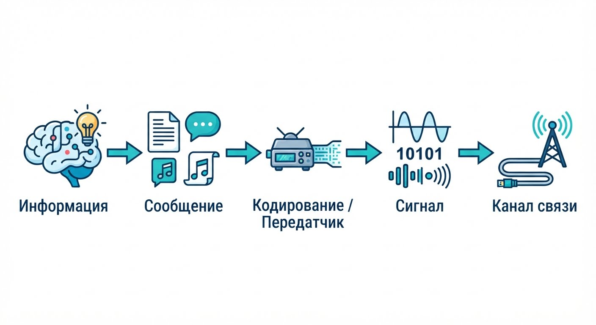

Мерой количества информации, содержащейся в сообщении о некотором событии, является **информация о событии**. Она зависит от вероятности его появления: чем менее вероятно событие, тем больше информации несёт сообщение о нём. Для события $a$ количество информации определяется формулой:

$$
I(a)=-\log_k p(a)
$$

где:

- $I(a)$ — количество информации;
- $p(a)$ — вероятность события;
- $k$ — основание логарифма, определяющее единицу измерения.

В информатике обычно используют двоичный логарифм ($k=2$), поэтому количество информации измеряется в битах:

$$
I(a)=-\log_2 p(a)
$$

**Примеры:**

- **Событие неизбежно ($p(a)=1$):** если сообщают, что завтра наступит утро, количество новой информации равно нулю.
- **Событие маловероятно:** сообщение о необычном событии несёт больше информации, чем сообщение о том, что происходит регулярно.
- **Два равновероятных исхода ($p(a)=0{,}5$):** при подбрасывании монетки информация о выпавшей стороне составляет $-\log_2 0{,}5=1$ бит.

Полный набор возможных сообщений вместе с вероятностями их появления называют **ансамблем сообщений**. Например, для подбрасывания монетки это два исхода: «Орёл» и «Решка», вероятность каждого из которых равна $0{,}5$.

### Классификация сигналов

Сигналы классифицируют по двум независимым признакам: **характеру изменения во времени** и **способу представления значений (уровней) сигнала**.

По времени различают:

- **Непрерывные сигналы** — определены в любой момент времени.
- **Дискретные сигналы** — заданы только в отдельные моменты времени, называемые отсчётами.

По уровню различают:

- **Неквантованные сигналы** — могут принимать любые значения в некотором диапазоне.
- **Квантованные сигналы** — могут принимать только определённые значения из конечного набора допустимых уровней.

В зависимости от сочетания этих признаков выделяют четыре основных вида сигналов:

| Название сигнала | По времени | По уровню | Пример |
|---|---|---|---|
| Аналоговый | Непрерывный | Неквантованный | Звуковой сигнал, создаваемый человеческим голосом |
| Дискретный | Дискретный | Неквантованный | Отсчёты температуры, полученные через определённые промежутки времени |
| Квантованный | Непрерывный | Квантованный | Сигнал, амплитуда которого может принимать только заданные уровни |
| Цифровой | Дискретный | Квантованный | Последовательность отсчётов, значения которых представлены двоичными кодами |

Таким образом, **дискретизация** определяет моменты времени, в которые измеряются значения сигнала, а **квантование** ограничивает набор возможных значений этих отсчётов. Эти операции независимы друг от друга и могут рассматриваться отдельно.

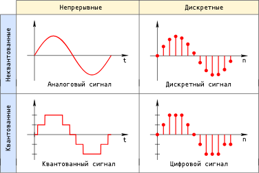

Также сигналы классифицируют по характеру повторения на **периодические** и **непериодические**.

**Периодический сигнал** повторяет свою форму через равные промежутки времени. Время одного полного повторения называется периодом. **Непериодический сигнал** не повторяет свою форму через постоянные промежутки времени. К таким сигналам относятся, например, речевые сообщения и случайные шумы.

### Гармонические колебания (сигналы)

Самый простой вид периодического сигнала — **гармоническое колебание**, форма которого описывается синусоидальной или косинусоидальной функцией. Эти записи описывают гармонические колебания; синус и косинус отличаются друг от друга фазовым сдвигом на $\frac{\pi}{2}$.

$$
s(t)=A\sin(\omega t+\varphi)
\qquad
s(t)=A\cos(\omega t+\varphi)
$$

где:

- $A$ — амплитуда, то есть максимальное отклонение сигнала от нулевого уровня;
- $\omega$ — угловая частота, определяющая скорость изменения фазы колебания;
- $\varphi$ — начальная фаза, определяющая фазу колебания в начальный момент времени;
- $t$ — время.

Угловая частота связана с обычной частотой ($f$) и периодом ($T$):

$$
\omega=2\pi f
\qquad
f=\frac{1}{T}
$$

Период $T$ — время одного полного колебания, измеряемое в секундах. Частота $f$ — количество полных колебаний за одну секунду, измеряемое в герцах (Гц).

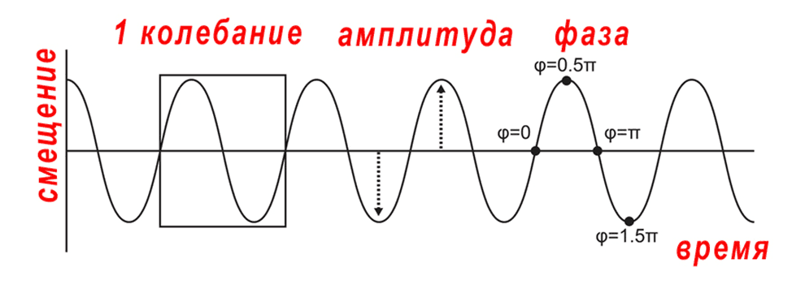

### Спектр сигнала

В реальных системах связи сигналы, например человеческая речь или музыка, обычно имеют сложную форму. Для их анализа используют представление в виде совокупности гармонических составляющих с различными частотами, амплитудами и фазами. Совокупность этих составляющих называют **спектром сигнала**.

 Для математического анализа спектра применяют методы Фурье:

- **Ряд Фурье** — позволяет представить периодический сигнал в виде суммы гармонических составляющих с определёнными частотами, амплитудами и фазами. Такой сигнал имеет дискретный спектр.
- **Преобразование Фурье** — применяется для анализа непериодических сигналов. В общем случае их спектр является непрерывным.

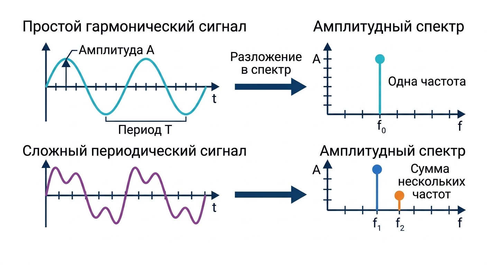

Для описания спектрального состава сигнала рассматривают две основные характеристики:

- **Амплитудный спектр** — показывает амплитуды гармонических составляющих на различных частотах.
- **Фазовый спектр** — показывает начальные фазы соответствующих гармонических составляющих.

Спектральное представление позволяет определить, в каком диапазоне частот сосредоточены составляющие сигнала и какая полоса частот необходима для его передачи. Диапазон частот, в пределах которого канал способен передавать сигналы с допустимым уровнем ослабления и искажений называется **полосой пропускания канала**. Если частотные составляющие сигнала выходят за пределы полосы пропускания канала, они могут значительно ослабляться или полностью подавляться. Это приводит к изменению формы принятого сигнала и может затруднить восстановление исходного сообщения.

### Основные характеристики сигналов

При передаче сигнала по линии связи необходимо учитывать его основные характеристики. К ним относятся:

| Характеристика | Обозначение | Смысл |
|:---|:---:|:---|
| **Длительность** | $T_c$ | Время, в течение которого передаётся сигнал |
| **Ширина спектра** | $\Delta F_c$ | Диапазон частот, занимаемый сигналом |
| **Динамический диапазон** | $D_c$ | Отношение максимального уровня сигнала к минимальному значимому уровню |

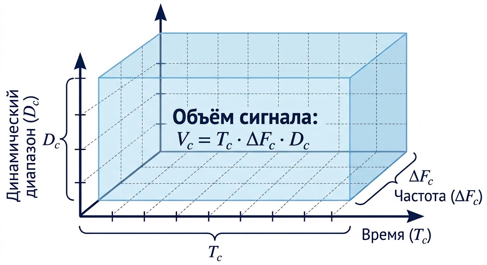

Для комплексной оценки сигнала используют понятие **объёма сигнала**, который определяется произведением длительности, ширины спектра и динамического диапазона:

$$
V_c=T_c\cdot\Delta F_c\cdot D_c
$$

Эта характеристика позволяет учитывать сразу несколько параметров сигнала. Чем дольше длится сообщение, чем шире его спектр и чем больше динамический диапазон, тем выше требования к ресурсам системы передачи.

### Мощность сигнала и децибелы

**Мощность сигнала** определяет, насколько уверенно его можно обнаружить и распознать на приёмной стороне на фоне шума и помех. Если $s(t)$ представляет собой напряжение, приложенное к нагрузке с сопротивлением $R$, мгновенная мощность определяется выражением:

$$
P(t)=\frac{s^2(t)}{R}
$$

Поскольку сигнал изменяется во времени, для периодических сигналов обычно рассчитывают **среднюю мощность** за период $T$:

$$
P_{\text{ср}}=\frac{1}{T}\int_0^T P(t)\,dt
$$

В системах связи мощности могут различаться на несколько порядков. Для удобства сравнения используют логарифмическую единицу — **децибел (дБ)**:

$$
P_{\text{дБ}}=10\log_{10}\left(\frac{P_2}{P_1}\right)
$$

Для измерения абсолютного уровня мощности относительно 1 мВт используют единицу **дБм**:

$$
P_{\text{дБм}}=10\log_{10}\left(\frac{P}{1\text{ мВт}}\right)
$$

Например:

- $1$ мВт соответствует $0$ дБм;
- $10$ мВт соответствует $10$ дБм;
- $100$ мВт соответствует $20$ дБм.

Для оценки различия между пиковым и средним уровнем сигнала используют **пик-фактор**:

$$
K_{\text{пик}}=10\log_{10}\left(\frac{P_{\text{пик}}}{P_{\text{ср}}}\right)
$$

**Динамический диапазон** по мощности определяется отношением максимальной мощности к минимальной:

$$
D=10\log_{10}\left(\frac{P_{\max}}{P_{\min}}\right)
$$

### Виды сигналов в электросвязи

В зависимости от передаваемого сообщения — речи, музыки, изображения или данных — сигналы могут существенно различаться по форме, частотному составу и требованиям к каналу связи.

**1. Речь и телефония.**

Человеческий голос содержит множество частотных составляющих. Для разборчивой передачи речи в традиционной телефонии обычно используют диапазон *от 300 до 3400 Гц*. Такой диапазон соответствует стандартному телефонному каналу **тональной частоты (ТЧ)**.

**2. Звуковое вещание.**

Для передачи музыки и других звуковых программ требуется более широкий частотный диапазон, чем для обычной телефонной речи. В зависимости от класса качества могут использоваться следующие диапазоны:

| Класс звукового вещания | Диапазон частот | Применение |
|:---|:---:|:---|
| **Высший** | *30–15 000 Гц* | Качественное звуковое вещание |
| **Первый** | *50–10 000 Гц* | Стандартное радиовещание и звуковое сопровождение телевидения |
| **Второй** | *100–6300 Гц* | Проводное радио и голосовые объявления |

**3. Телевизионный сигнал.**

Для передачи изображения необходимо преобразовать его в последовательность электрических сигналов. В классическом аналоговом телевидении изображение передавалось построчно, а для синхронизации приёмника использовались специальные **синхроимпульсы**.

В одной из классических систем аналогового телевидения кадр состоял из 625 строк, а частота смены кадров составляла 25 кадров в секунду. Полоса частот такого телевизионного сигнала могла составлять около *6,5 МГц*.

**4. Факсимильная связь.**

Факсимильная связь предназначена для передачи неподвижных изображений, например документов. Исходное изображение считывается построчно, а его участки преобразуются в электрический сигнал. Чем мельче детали изображения и выше скорость сканирования, тем более широкий частотный диапазон может потребоваться.

Максимальную частоту сигнала в упрощённой модели можно оценить по формуле:

$$
F_{\text{рис max}}=\frac{1}{2\tau_i}
$$

где $\tau_i$ — время прохождения одного минимального элемента изображения.

**5. Телеграфия и передача данных.**

При передаче цифровых данных информация представляется последовательностью отдельных символов. В простейшем случае используются два состояния сигнала, соответствующие логическим значениям `0` и `1`. Для передачи применяются **импульсы**, которые могут различаться амплитудой, длительностью, частотой или фазой.

### Преобразование аналогового сигнала в цифровую форму

Аналоговые сигналы могут быть преобразованы в цифровую последовательность, которую можно обрабатывать, хранить и передавать с помощью цифровых систем. Этот процесс называется **аналого-цифровым преобразованием (АЦП)**.

Преобразование включает три последовательных этапа: дискретизацию, квантование и кодирование.

1. **Дискретизация.**

Дискретизация — это измерение значения аналогового сигнала через определённые промежутки времени. В результате вместо непрерывного сигнала получается последовательность отдельных значений, называемых **отсчётами**.

Частота дискретизации показывает, сколько отсчётов получается за одну секунду:

$$
f_s=\frac{1}{T_s}
$$

где:

- $f_s$ — частота дискретизации, измеряемая в герцах (Гц);
- $T_s$ — период дискретизации, то есть промежуток времени между соседними отсчётами.

Чтобы исходный сигнал можно было восстановить без потери информации в идеальных условиях, частота дискретизации должна быть не менее чем в два раза выше максимальной частоты сигнала. Это условие называется **теоремой Котельникова — Найквиста**.

2. **Квантование.**

Квантование — это замена фактического значения каждого отсчёта ближайшим значением из заранее заданного набора допустимых уровней, называемых **уровнями квантования**. Например, если система использует уровни 0, 1, 2, 3 и 4 В, то измеренное значение 2,7 В будет заменено ближайшим уровнем — 3 В. Таким образом, вместо произвольных значений амплитуды система использует ограниченное количество допустимых значений. Количество уровней квантования зависит от числа бит, выделенных на представление одного отсчёта:

$$
L=2^n
$$

где:

- $L$ — количество уровней квантования;
- $n$ — количество бит на один отсчёт.

Например, при использовании 8 бит можно представить $2^8=256$ различных уровней. Чем больше уровней квантования, тем точнее можно представить исходный сигнал и тем меньше ошибка квантования.

3. **Кодирование.**

Кодирование — это представление результатов квантования в виде двоичных чисел. Каждому уровню квантования присваивается определённая последовательность битов, по которой можно определить значение соответствующего отсчёта. Например, если используется 8-битное кодирование, каждому отсчёту соответствует восьмиразрядное двоичное число. Поскольку 8 бит позволяют представить $2^8=256$ различных комбинаций, этого достаточно для кодирования 256 уровней квантования. В результате кодирования формируется последовательность битов, которую можно обрабатывать, хранить и передавать с помощью цифровых систем.

Таким образом, при аналого-цифровом преобразовании дискретизация определяет моменты измерения сигнала, квантование задаёт допустимые значения отсчётов, а кодирование представляет эти значения в двоичной форме.

### Методы цифрового кодирования аналоговых сигналов

Существует несколько методов цифрового кодирования, которые могут быть задействованы в ходе АЦП на этапе кодирования. Они отличаются тем, какая информация об отсчётах передаётся.

1. **Импульсно-кодовая модуляция (ИКМ, PCM).** *Именно он был приведен выше на этапе кодирования.*

Импульсно-кодовая модуляция (ИКМ) — это метод, при котором каждый отсчёт аналогового сигнала независимо преобразуется в двоичный код, соответствующий его значению. Другими словами, система измеряет сигнал, определяет ближайший уровень квантования и записывает его двоичным числом. При этом для каждого отсчёта передаётся его полное значение, а не разница с предыдущим. Например, представим, что после квантования получена последовательность значений:

$$
2,\ 3,\ 5,\ 4,\ 6
$$

Если для представления каждого значения выделено 3 бита, то каждому отсчёту соответствует отдельный двоичный код:

| Значение отсчёта | Двоичный код |
|---:|:---:|
| 2 | `010` |
| 3 | `011` |
| 5 | `101` |
| 4 | `100` |
| 6 | `110` |

В результате получается последовательность:

`010 011 101 100 110`

Таким образом, при ИКМ каждый отсчёт кодируется независимо, а его разрядность остаётся фиксированной. Например, если на один отсчёт выделяется 8 бит, то можно представить $2^8=256$ различных уровней квантования.

2. **Дифференциальная импульсно-кодовая модуляция (ДИКМ, DPCM).**

Дифференциальная импульсно-кодовая модуляция (ДИКМ) — это метод, при котором вместо полного значения отсчёта кодируется разница между его фактическим и предсказанным значениями.

Идея заключается в следующем: если соседние отсчёты похожи друг на друга, нет необходимости каждый раз передавать полное значение. Можно предсказать очередной отсчёт по предыдущим значениям и передать только отклонение от этого прогноза. Допустим, система получила следующие значения отсчётов:

$$
10,\ 12,\ 13,\ 15,\ 14
$$

Предположим, что для каждого следующего отсчёта система использует предыдущее значение в качестве прогноза. Тогда фактические значения сравниваются с предсказанными:

| Отсчёт | Фактическое значение | Предсказанное значение | Разность |
|---:|---:|---:|---:|
| 1 | 10 | 10 | 0 |
| 2 | 12 | 10 | +2 |
| 3 | 13 | 12 | +1 |
| 4 | 15 | 13 | +2 |
| 5 | 14 | 15 | −1 |

Разность между фактическим и предсказанным значениями называется **ошибкой предсказания** и определяется выражением:

$$
e[n]=x[n]-\hat{x}[n]
$$

где:

- $x[n]$ — фактическое значение текущего отсчёта;
- $\hat{x}[n]$ — предсказанное значение;
- $e[n]$ — ошибка предсказания.

В нашем примере вместо последовательности полных значений:

$$
10,\ 12,\ 13,\ 15,\ 14
$$

можно передать последовательность разностей:

$$
0,\ +2,\ +1,\ +2,\ -1
$$

В нашем примере вместо передачи полных значений отсчётов передаётся разность между каждым текущим значением и предыдущим. Это позволяет передавать не сами значения, а только информацию о том, насколько они изменились.

На принимающей стороне выполняется такое же предсказание, как и на передающей. К предсказанному значению прибавляется полученная разность, благодаря чему восстанавливается исходное значение отсчёта. Например, если предсказанное значение равно 12, а полученная разность — +1, то восстановленное значение составит 13.

Таким образом, ДИКМ использует сходство соседних отсчётов, чтобы уменьшить объём передаваемых данных. Чем точнее предсказание, тем меньше разность между фактическим и предсказанным значениями и тем меньше бит может потребоваться для её кодирования.

3. **Дельта-модуляция (DM).**

Дельта-модуляция (DM) — это упрощённый вариант дифференциального кодирования, при котором передаётся не точное значение ошибки предсказания, а только направление изменения сигнала. В отличие от ДИКМ, где передаётся величина разности, дельта-модуляция сообщает только одно из двух состояний:

- сигнал увеличился;
- сигнал уменьшился.

Для этого используется фиксированный шаг изменения $\Delta$. На каждом этапе система сравнивает текущее значение сигнала с предыдущим приближённым значением:

- если фактическое значение выше приближённого, передаётся `1`, а приближение увеличивается на $\Delta$;
- если фактическое значение ниже приближённого, передаётся `0`, а приближение уменьшается на $\Delta$.

Пусть начальное приближённое значение равно 10, а шаг изменения $\Delta=1$. Если сигнал постепенно увеличивается, система будет передавать единицы, каждый раз повышая своё приближение на единицу:

| Шаг | Переданный бит | Новое приближённое значение |
|---:|:---:|---:|
| 1 | `1` | 11 |
| 2 | `1` | 12 |
| 3 | `1` | 13 |
| 4 | `0` | 12 |
| 5 | `1` | 13 |

Таким образом, вместо передачи полных значений или точных разностей система передаёт только последовательность битов, указывающих направление изменения сигнала.

В простейшем варианте дельта-модуляции используется один бит на каждый отсчёт. Это делает метод достаточно простым и позволяет уменьшить объём передаваемых данных. Однако у метода есть ограничения. Если сигнал изменяется слишком быстро, приближение может не успевать за ним. Если же шаг изменения слишком велик, приближённое значение может колебаться около исходного сигнала, создавая дополнительные искажения.

| Метод | Что передаётся | Основная особенность |
|:---|:---|:---|
| **ИКМ (PCM)** | Полное значение каждого отсчёта | Простой способ представления сигнала, но требует больше бит |
| **ДИКМ (DPCM)** | Разность между фактическим и предсказанным значениями | Использует предсказание и позволяет уменьшить объём данных |
| **Дельта-модуляция (DM)** | Направление изменения сигнала | В простейшем варианте использует один бит на отсчёт |

Таким образом, все три метода позволяют представить аналоговый сигнал в цифровой форме, но используют разные способы кодирования отсчётов. ИКМ передаёт полные значения, ДИКМ — отклонения от предсказанных значений, а дельта-модуляция — только направление изменения сигнала.

Важно различать **преобразование аналогового сигнала в цифровую форму** и **модуляцию несущего колебания**. ИКМ, ДИКМ и дельта-модуляция формируют цифровое представление исходного сигнала. Для передачи полученной последовательности по радиоканалу или другому каналу, использующему несущие колебания, дополнительно может применяться цифровая модуляция, например ASK, FSK, PSK или QAM.

### Модуляция несущего колебания

Не каждый канал связи позволяет передавать информационный сигнал непосредственно в исходном виде. Например, при радиопередаче сигнал необходимо преобразовать таким образом, чтобы его можно было эффективно излучать и принимать с помощью антенн. Для этого используется высокочастотное колебание, называемое **несущим**. В качестве несущего обычно используется гармоническое колебание, основные характеристики которого — амплитуда, частота и фаза — были рассмотрены ранее.

Информационный сигнал переносят на несущую путём изменения одного или нескольких её параметров. Этот процесс называется **модуляцией**. В процессе модуляции один или несколько параметров несущего колебания изменяются под воздействием информационного сигнала. В зависимости от изменяемого параметра различают амплитудную, частотную и фазовую модуляцию.

В аналоговых системах параметры несущей изменяются непрерывно в соответствии с информационным сигналом. При цифровой же передаче каждому передаваемому символу соответствуют определённые состояния несущего сигнала. Такой способ изменения параметров несущей называют **цифровой манипуляцией**.

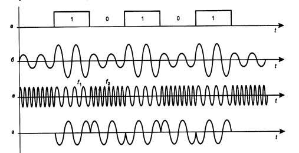

| Вид модуляции | Аналоговая модуляция | Цифровая модуляция (манипуляция) |
|:---|:---|:---|
| **Амплитудная (AM / ASK)** | Амплитуда несущего колебания непрерывно изменяется в соответствии с информационным сигналом. | Амплитуда несущего колебания принимает определённые дискретные значения в зависимости от передаваемых символов. |
| **Частотная (FM / FSK)** | Мгновенная частота несущего колебания непрерывно изменяется в соответствии с информационным сигналом. | Передаваемым символам соответствуют определённые значения частоты несущего колебания. |
| **Фазовая (PM / PSK)** | Фаза несущего колебания непрерывно изменяется в соответствии с информационным сигналом. | Передаваемым символам соответствуют определённые значения фазы несущего колебания. |

Таким образом, при амплитудной модуляции изменяется амплитуда несущей, при частотной — её мгновенная частота, а при фазовой — фаза.

### Скорость передачи данных и скорость модуляции

При цифровой передаче важно различать **скорость передачи данных** и **скорость передачи символов (скорость модуляции)**. Первая показывает, сколько бит передаётся за одну секунду, а вторая — сколько символов сигнала передаётся за это же время.

**Скорость передачи данных** измеряется в битах в секунду (бит/с) и показывает количество передаваемых битов за одну секунду. При использовании различных методов цифрового кодирования скорость получаемого потока зависит от количества бит, выделяемых на представление каждого отсчёта.

Рассмотрим расчёт скорости цифрового потока для различных методов кодирования. При фиксированной разрядности кодирования скорость цифрового потока определяется общей формулой:

$$
R_b=f_s\cdot n
$$

где:

- $R_b$ — скорость цифрового потока, бит/с;
- $f_s$ — частота дискретизации, отсчётов/с;
- $n$ — количество бит на один отсчёт.

Эта формула применима к рассматриваемым методам цифрового кодирования:

1. **ИКМ:** каждый отсчёт кодируется собственным двоичным кодом. Например, при разрядности 8 бит и частоте дискретизации 8000 отсчётов/с скорость потока составляет:

$$
R_b=8000\cdot8=64000\text{ бит/с}=64\text{ кбит/с}
$$

2. **ДИКМ:** кодируется разность между фактическим и предсказанным значениями отсчёта. Если на одну разность выделяется 4 бита:

$$
R_b=8000\cdot4=32000\text{ бит/с}=32\text{ кбит/с}
$$

3. **Дельта-модуляция:** в простейшем варианте на каждый отсчёт передаётся один бит:

$$
R_b=8000\cdot1=8000\text{ бит/с}=8\text{ кбит/с}
$$

Таким образом, при одинаковой частоте дискретизации скорость цифрового потока зависит от количества бит, используемых для представления каждого отсчёта.

**Скорость передачи символов** показывает, сколько символов сигнала передаётся за одну секунду. Она измеряется в **бодах**. Один символ представляет собой определённое состояние сигнала, которое передатчик формирует для передачи информации. Если длительность одного символа равна $\tau_i$, скорость передачи символов определяется выражением:

$$
R_s=\frac{1}{\tau_i}
$$

где:

- $R_s$ — скорость передачи символов, бод;
- $\tau_i$ — длительность одного символа, секунд.

Количество бит, которое может представлять один символ, зависит от числа различимых состояний сигнала. Если сигнал может принимать $M$ различных состояний, теоретическое количество бит на один символ определяется выражением:

$$
n=\log_2 M
$$

Например, если сигнал имеет четыре различимых состояния, один символ может представлять два бита, поскольку $2^2=4$. Таким образом, скорость передачи данных зависит не только от количества передаваемых символов, но и от количества бит, которое кодирует каждый символ:

$$
R_b=R_s\cdot\log_2 M
$$

где:

- $R_b$ — скорость передачи данных, бит/с;
- $R_s$ — скорость передачи символов, бод;
- $M$ — количество различимых состояний сигнала.

Для **двоичного сигнала** ($M=2$) каждый символ представляет один бит. Поэтому численные значения скорости передачи данных и скорости передачи символов совпадают.

Для **многопозиционного сигнала** ($M>2$) один символ может представлять несколько бит. Например, при четырёх состояниях каждый символ кодирует два бита, а при шестнадцати — четыре. Поэтому за одинаковое количество символов можно передать больше бит.

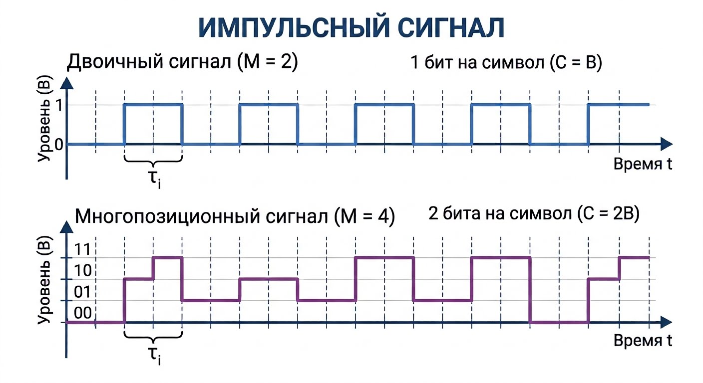

Следовательно, скорость передачи символов показывает, сколько символов передаётся за секунду, а скорость передачи данных — сколько бит передаётся за это же время. Чем больше бит кодируется одним символом, тем выше скорость передачи данных при одинаковой символьной скорости.

### Квадратурная амплитудная модуляция (QAM)

**Квадратурная амплитудная модуляция (QAM, Quadrature Amplitude Modulation)** — метод цифровой модуляции, при котором информация передаётся посредством одновременного изменения амплитуды и фазы несущего колебания. Благодаря этому за один символ можно передать несколько бит информации. Основная идея QAM заключается в использовании двух гармонических составляющих одинаковой частоты, сдвинутых относительно друг друга на 90°. Они называются:

- **I (In-phase)** — синфазная составляющая;
- **Q (Quadrature)** — квадратурная составляющая.

Математически сигнал QAM можно представить следующим образом:

$$
s(t)=I\cos(2\pi f_ct)-Q\sin(2\pi f_ct)
$$

где:

- $I$ — амплитуда синфазной составляющей;
- $Q$ — амплитуда квадратурной составляющей;
- $f_c$ — частота несущего колебания;
- $t$ — время.

Изменяя значения $I$ и $Q$, передатчик формирует различные комбинации амплитуды и фазы результирующего сигнала. Его амплитуда определяется выражением:

$$
A=\sqrt{I^2+Q^2}
$$

А фаза может быть вычислена как:

$$
\varphi=\operatorname{atan2}(Q,I)
$$

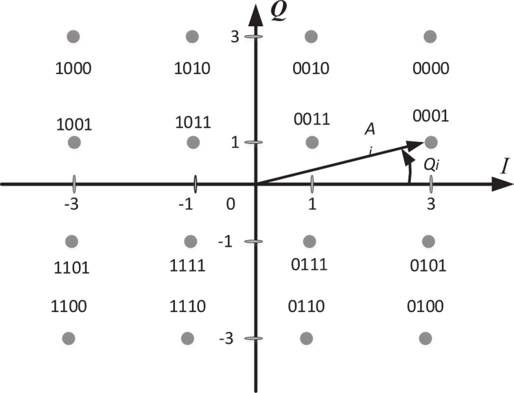

Для наглядного представления QAM используют **сигнальное созвездие (Constellation Diagram)** — график, на котором каждая возможная комбинация значений $I$ и $Q$ представлена отдельной точкой. В декартовой системе координат горизонтальная ось соответствует составляющей $I$, а вертикальная — составляющей $Q$.

Каждая точка обозначает определённый символ, который передатчик может отправить по каналу связи. Например, в 16-QAM используется 16 различных точек, расположенных в виде матрицы 4 × 4. Количество бит, передаваемых одним символом, определяется формулой:

$$
n=\log_2 M
$$

где:

- $n$ — количество бит на один символ;
- $M$ — количество возможных состояний сигнала.

Для 16-QAM:

$$
n=\log_2 16=4
$$

Следовательно, каждый символ 16-QAM передаёт 4 бита информации.

| Тип модуляции | Количество состояний | Бит на символ |
|:---|---:|---:|
| 4-QAM | 4 | 2 |
| 16-QAM | 16 | 4 |
| 64-QAM | 64 | 6 |
| 256-QAM | 256 | 8 |
| 1024-QAM | 1024 | 10 |

Чем больше состояний используется, тем больше информации можно передать за один символ. Однако при увеличении количества точек созвездия расстояние между соседними состояниями обычно уменьшается. Поэтому приёмнику становится сложнее различать их на фоне шума и помех. Применение высоких порядков QAM требует более высокого отношения сигнал/шум (SNR) и достаточно качественного канала связи.

Теперь если применить формулу вычисления скорость передачи информации при использовании $M$ различных состояний сигнала из раздела выше:

$$
R_b=R_s\log_2 M
$$

Например, при скорости передачи символов 1000 бод:

- 4-QAM обеспечивает 2000 бит/с;
- 16-QAM обеспечивает 4000 бит/с;
- 64-QAM обеспечивает 6000 бит/с;
- 256-QAM обеспечивает 8000 бит/с.

То мы обнаружим, что QAM позволяет увеличивать скорость передачи информации без пропорционального увеличения скорости передачи символов.

На данный момент, QAM широко применяется в современных системах связи:

- Wi-Fi;
- мобильных сетях 4G и 5G;
- кабельном телевидении и кабельном интернете;
- цифровых радиорелейных системах связи.

## Блок 2. Каналы передачи и линии связи

### Понятие канала и его основные характеристики

Для передачи сообщения от источника к получателю используется **канал электросвязи (канал передачи)** — совокупность технических средств и среды распространения, обеспечивающих передачу сигналов с определёнными характеристиками и заданным качеством.

При этом важно различать **канал передачи** и **линию связи**. Канал характеризует функциональные возможности системы передачи информации, а линия связи представляет собой физическую среду, по которой распространяется сигнал.

Например, телефонный канал может быть организован с использованием медного кабеля, оптоволокна или радиорелейной системы. Физическая среда передачи в этих случаях различается, однако назначение канала остаётся одинаковым — передача речевой информации.

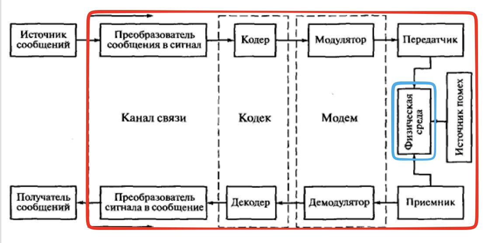

Для обеспечения качественной передачи характеристики канала должны соответствовать параметрам передаваемого сигнала. В качестве основных характеристик канала можно выделить эффективную полосу частот, время предоставления и динамический диапазон.

| Характеристика канала | Обозначение | Смысл |
|:---|:---:|:---|
| Эффективная полоса частот | $\Delta F_k$ | Диапазон частот, в котором канал обеспечивает передачу с заданным качеством |
| Время предоставления | $T_k$ | Время, в течение которого канал доступен для передачи |
| Динамический диапазон | $D_k$ | Диапазон уровней мощности сигналов, которые канал способен передавать |

**Эффективная полоса частот канала** определяет диапазон частот, в пределах которого канал обеспечивает передачу сигнала с допустимым уровнем искажений. Если спектр передаваемого сигнала выходит за пределы полосы пропускания канала, отдельные его составляющие могут ослабляться или полностью теряться. Это приводит к искажению исходного сигнала.

**Время предоставления канала** определяет продолжительность, в течение которой он может использоваться для передачи информации. Например, при телефонном соединении канал предоставляется на время разговора, а после завершения соединения может быть освобождён для других абонентов.

**Динамический диапазон канала** характеризует диапазон мощностей сигналов, при котором обеспечивается передача с допустимым качеством. Он определяется отношением максимальной и минимальной допустимой мощности сигнала:

$$
D_k=10\log_{10}\left(\frac{W_{k\max}}{W_{k\min}}\right)
$$

где:

- $W_{k\max}$ — максимальная допустимая мощность сигнала;
- $W_{k\min}$ — минимальная допустимая мощность сигнала.

Динамический диапазон измеряется в децибелах (дБ). Максимальная мощность ограничивается возможностью перегрузки оборудования и возникновения нелинейных искажений, а минимальная — уровнем шумов и помех, которые могут сделать сигнал неразличимым на приёмной стороне. Для оценки соответствия параметров сигнала возможностям канала используются следующие условия:

$$
T_c\leq T_k
$$

$$
\Delta F_c\leq\Delta F_k
$$

$$
D_c\leq D_k
$$

где параметры сигнала обозначаются индексом $c$, а параметры канала — индексом $k$.

Таким образом, канал должен предоставляться на достаточное время, обладать подходящей полосой частот и поддерживать необходимый динамический диапазон. Если хотя бы одно из этих условий не выполняется, передача может сопровождаться потерей информации или искажением сигнала.

### Классификация каналов

Каналы связи классифицируются по нескольким признакам: способу передачи информации, полосе частот, используемой среде, назначению, организации двусторонней связи и территории обслуживания.

| Признак классификации | Виды каналов |
|:---|:---|
| Способ передачи | Аналоговые, цифровые, смешанные |
| Полоса пропускания | Тональной частоты, широкополосные, звукового вещания, телевизионные |
| Среда передачи | Проводные и радиоканалы |
| Назначение | Телефонные, телевизионные, факсимильные, телеграфные, каналы передачи данных |
| Организация двусторонней связи | Двухпроводные и четырёхпроводные |
| Территория обслуживания | Местные, зоновые, магистральные, междугородные, международные |

**Аналоговые каналы** предназначены для передачи информации посредством непрерывно изменяющегося сигнала. Его параметры изменяются в соответствии с передаваемым сообщением. Например, в аналоговом телефонном канале речевой сигнал передаётся в виде электрических колебаний, форма которых соответствует исходному звуку.

**Цифровые каналы** обеспечивают передачу информации в виде последовательности дискретных символов, представленных цифровыми кодами. Передаваемые данные могут быть получены непосредственно в цифровой форме или сформированы в результате преобразования аналогового сигнала.

**Смешанные каналы** включают как аналоговые, так и цифровые участки. В таких системах преобразование аналогового сигнала в цифровую форму и обратно выполняется с помощью аналого-цифровых и цифро-аналоговых преобразователей.

### Основной цифровой канал и ISDN

Одним из базовых элементов цифровых систем передачи является **основной цифровой канал (ОЦК)** со скоростью передачи 64 кбит/с. ОЦК соответствует цифровому представлению телефонного канала, сформированному с использованием импульсно-кодовой модуляции. При стандартной частоте дискретизации 8000 отсчётов/с и разрядности 8 бит скорость цифрового потока составляет:

$$
R_b=8000\cdot8=64000\text{ бит/с}
$$

Таким образом, один основной цифровой канал обеспечивает передачу данных со скоростью 64 кбит/с. Он используется как базовая единица для построения более высокоскоростных систем цифровой передачи.

В цифровой телефонии также применялась технология **ISDN (Integrated Services Digital Network)** — цифровая сеть с интеграцией служб. Она позволяет передавать голос, данные и служебную информацию по одной цифровой абонентской линии. Одним из вариантов подключения является **базовый доступ ISDN**, обозначаемый как **2B+D**. Он включает три логических канала:

- Два информационных канала B со скоростью 64 кбит/с каждый.
- Один сигнальный канал D со скоростью 16 кбит/с.

Каналы B предназначены для передачи пользовательской информации, например речи или данных. Канал D используется для служебной сигнализации: установления соединения, его завершения и управления вызовами.

Суммарная скорость этих каналов определяется следующим образом:

$$
C=2\cdot64+16=144\text{ кбит/с}
$$

Таким образом, базовый доступ ISDN позволяет одновременно передавать информацию по двум независимым информационным каналам и использовать отдельный канал для служебной сигнализации. При этом 144 кбит/с — суммарная скорость передачи информации по логическим каналам B и D. Физический интерфейс передаёт также дополнительные служебные биты, необходимые для синхронизации и организации передачи. Они занимают часть пропускной способности линии, поэтому её фактическая скорость выше 144 кбит/с.

В настоящее время ISDN в большинстве телекоммуникационных сетей вытеснена IP-телефонией, однако технология сохраняет историческое и учебное значение как пример цифровой сети с интеграцией служб и коммутацией каналов.

### Групповые тракты и мультиплексирование

Одна физическая линия связи может использоваться для передачи нескольких независимых информационных потоков. Для этого применяется **мультиплексирование** — процесс объединения нескольких потоков в общий сигнал или поток данных для совместной передачи по одной физической линии. На приёмной стороне выполняется **демультиплексирование** — разделение общего потока на исходные составляющие.

В системах с коммутацией каналов объединённые потоки могут представлять собой отдельные логические каналы, формирующие **групповой тракт**. В сетях с коммутацией пакетов совместно передаются пакеты разных информационных потоков, использующих общую сетевую инфраструктуру.

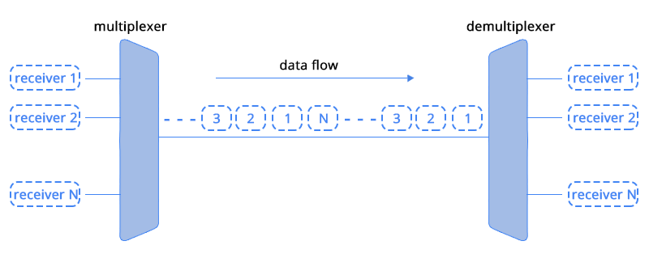

Для совместной передачи нескольких информационных потоков по одной физической линии применяются различные методы мультиплексирования:

- **FDM (Frequency Division Multiplexing)** — частотное мультиплексирование. Общий частотный диапазон разделяется на отдельные полосы, каждая из которых используется для передачи своего сигнала. Благодаря этому несколько сигналов могут передаваться одновременно на разных частотах.
- **TDM (Time Division Multiplexing)** — временное мультиплексирование. Передача организуется с помощью временных интервалов, которые распределяются между информационными потоками. Каждый поток получает возможность передавать данные в отведённые ему интервалы времени.
- **WDM (Wavelength Division Multiplexing)** — спектральное мультиплексирование по длинам волн. В оптическом волокне одновременно передаются несколько оптических сигналов, каждый из которых использует свою длину волны.

Таким образом, мультиплексирование позволяет совместно использовать пропускную способность физической линии связи несколькими информационными потоками. Конкретный способ их разделения зависит от применяемой технологии: по частоте, времени или длине волны.

### Иерархии цифровой передачи PDH и SDH

В предыдущем разделе было рассмотрено временное мультиплексирование (TDM) — принцип объединения нескольких цифровых потоков для передачи по одной физической линии связи. На практике этот принцип реализуется с помощью специальных транспортных систем, которые определяют порядок объединения потоков, их синхронизацию и организацию передачи. К таким системам относятся **цифровые транспортные иерархии PDH и SDH**. Они позволяют последовательно объединять цифровые потоки в более высокоскоростные, обеспечивая совместную передачу большого количества информации по одной линии связи.

**PDH (Plesiochronous Digital Hierarchy)** — плезиохронная цифровая иерархия, представляющая собой систему последовательного объединения цифровых потоков в потоки с более высокой скоростью передачи. Несколько потоков объединяются в один общий поток, который затем может объединяться с другими потоками следующего уровня. Таким образом формируется многоуровневая иерархия передачи данных. Название «плезиохронная» означает, что тактовые частоты отдельных потоков почти совпадают, но не являются строго одинаковыми. Это связано с тем, что оборудование, формирующее потоки, использует независимые тактовые генераторы.

При объединении таких потоков необходимо учитывать небольшие различия в скорости поступления данных. Для этого PDH использует специальные **процедуры согласования скоростей**, в том числе добавление служебных битов выравнивания. Они позволяют корректно объединять потоки с немного различающимися тактовыми частотами.

Каждый следующий уровень формируется путём объединения четырёх потоков предыдущего уровня. При этом добавляется служебная информация, необходимая для организации передачи и согласования скоростей. Поэтому скорость итогового потока немного отличается от простой суммы скоростей исходных потоков. В европейской иерархии PDH используются следующие уровни:

| Уровень | Скорость передачи |
|:---:|---:|
| E1 | 2,048 Мбит/с |
| E2 | 8,448 Мбит/с |
| E3 | 34,368 Мбит/с |
| E4 | 139,264 Мбит/с |

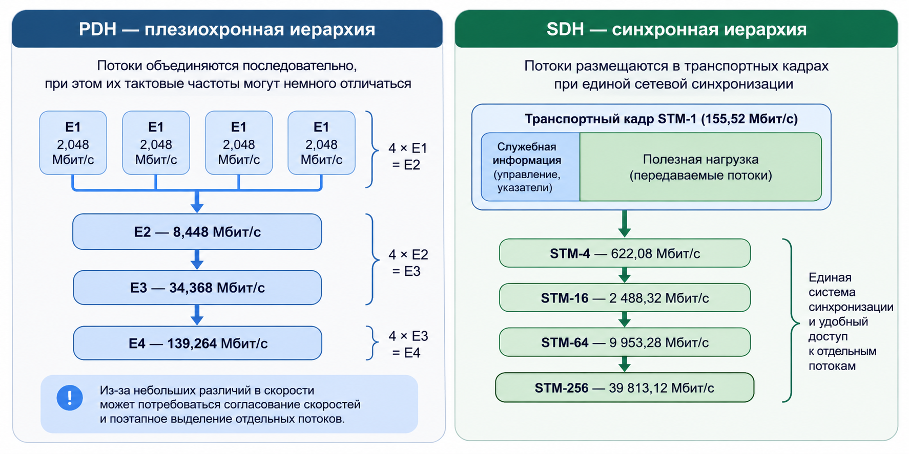

Особенность PDH заключается в том, что для получения отдельного исходного потока из высокоскоростного обычно приходится последовательно выполнять обратное мультиплексирование на промежуточных уровнях. Кроме того, необходимость согласования скоростей усложняет управление передачей.

Для решения этих ограничений была разработана **SDH (Synchronous Digital Hierarchy)** — синхронная цифровая иерархия. Она также реализует принцип временного мультиплексирования, но использует другую организацию передачи цифровых потоков. В SDH применяется общая система сетевой синхронизации. Сетевые элементы используют согласованную опорную частоту, благодаря чему их работа синхронизирована по времени. Это упрощает объединение цифровых потоков и уменьшает необходимость согласования скоростей, характерную для PDH.

Передача в SDH организована с помощью стандартизированных транспортных кадров. Каждый кадр содержит полезную нагрузку — передаваемые цифровые данные, а также служебную информацию для управления и контроля передачи. Для определения положения полезной нагрузки внутри транспортных кадров используются специальные указатели. Благодаря этому можно выделить нужный цифровой поток непосредственно из общего высокоскоростного потока, не разбирая последовательно все промежуточные уровни иерархии. Основные уровни SDH:

| Уровень | Скорость передачи |
|:---:|---:|
| STM-1 | 155,52 Мбит/с |
| STM-4 | 622,08 Мбит/с |
| STM-16 | 2488,32 Мбит/с |
| STM-64 | 9953,28 Мбит/с |
| STM-256 | 39813,12 Мбит/с |

**Главное различие между PDH и SDH** заключается в способах организации синхронизации и доступа к передаваемым потокам. PDH объединяет потоки с близкими, но не полностью совпадающими тактовыми частотами, поэтому требует согласования скоростей и последовательного прохождения промежуточных уровней для выделения отдельных составляющих. SDH использует общую систему сетевой синхронизации и стандартизированную структуру транспортных кадров, что упрощает объединение потоков, управление ими и выделение отдельных составляющих.

Таким образом, PDH и SDH реализуют принцип временного мультиплексирования, но используют разные способы организации транспортной передачи. SDH стала более совершенной транспортной технологией и во многом вытеснила PDH при построении высокоскоростных сетей операторов связи.

### Двусторонняя связь и устойчивость канала

Рассмотренные цифровые транспортные иерархии PDH и SDH позволяют объединять множество информационных потоков и передавать их по одной физической линии связи. Однако для организации полноценной электросвязи часто требуется обеспечить передачу информации одновременно в двух направлениях. Например, во время телефонного разговора каждый абонент должен иметь возможность передавать и принимать речевой сигнал.

Для организации двусторонней передачи применяются **двухпроводные и четырёхпроводные схемы связи**. Они различаются способом организации физических цепей для передачи сигналов в прямом и обратном направлениях.

**Двухпроводная система связи** использует одну пару проводников для передачи сигналов в обоих направлениях. Передаваемый и принимаемый сигналы распространяются по одной физической линии, поэтому на оконечном оборудовании необходимо разделять их между передающим и приёмным трактами. Такая схема позволяет организовать двустороннюю связь с использованием всего двух проводников, что удобно, например, для абонентских телефонных линий.

**Четырёхпроводная система связи** использует две отдельные пары проводников: одна предназначена для передачи сигнала в прямом направлении, а другая — в обратном. Благодаря этому направления передачи физически разделены, что уменьшает взаимное влияние передаваемого и принимаемого сигналов и позволяет организовать независимые передающий и приёмный тракты.

Для сопряжения двухпроводных и четырёхпроводных участков применяются специальные устройства — **гибридные схемы** (дифференциальные системы). Они преобразуют общую двухпроводную цепь в раздельные передающий и приёмный тракты и выполняют обратное преобразование на другом конце соединения. При этом гибридная схема должна направлять сигналы в соответствующие цепи и обеспечивать достаточную развязку между ними.

Таким образом, двухпроводная схема использует одну пару проводников для обоих направлений передачи, а четырёхпроводная — отдельную пару для каждого направления. Гибридные схемы позволяют сопрягать эти варианты организации связи.

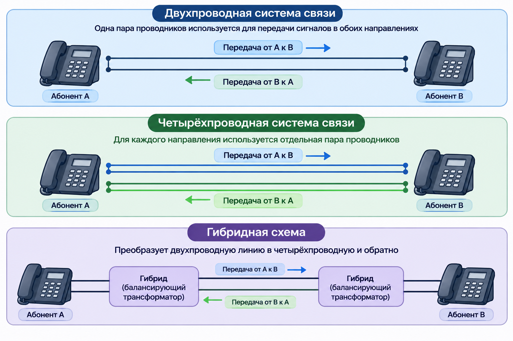

При организации двусторонней связи важно не только разделить направления передачи, но и обеспечить достаточную изоляцию между передающим и приёмным трактами. Особенно это актуально для двухпроводных систем, в которых оба направления используют одну физическую линию, а их разделение выполняется с помощью гибридных схем. В реальных устройствах такое разделение не является идеальным. Из-за несовершенной балансировки гибридной схемы часть передаваемого сигнала может проникать в приёмный тракт. Если этот сигнал затем возвращается на вход передающего устройства, возникает **обратная связь**.

**Обратная связь** — это процесс, при котором часть выходного сигнала системы возвращается на её вход. В результате образуется замкнутый контур, по которому сигнал может повторно проходить через элементы системы и усиливаться. При определённых условиях такая петля может привести к **самовозбуждению** — возникновению устойчивых колебаний без соответствующего внешнего входного сигнала. Для оценки устойчивости рассматривают коэффициент передачи петли обратной связи, который определяется произведением коэффициентов передачи всех элементов замкнутого контура:

$$
K_{\text{петли}}=K_1\cdot K_2\cdot\ldots\cdot K_n
$$

В общем случае коэффициенты передачи зависят от частоты, поэтому условие возникновения самовозбуждения рассматривают для конкретной частоты. Оно возможно, если модуль коэффициента передачи петли достигает или превышает единицу, а суммарный фазовый сдвиг соответствует положительной обратной связи. При таких условиях возвращающийся сигнал может усиливаться при каждом прохождении контура.

Для предотвращения самовозбуждения необходимо обеспечить достаточное затухание в петле обратной связи, чтобы модуль её коэффициента передачи оставался меньше единицы на частотах, где выполняется условие положительной обратной связи. Для этого улучшают развязку передающего и приёмного трактов и контролируют параметры элементов системы.

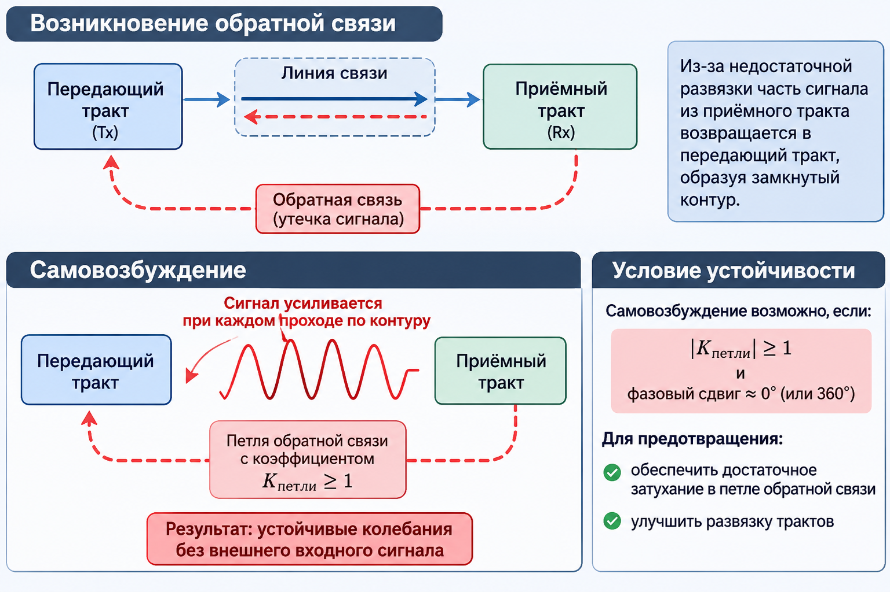

Таким образом, надёжная работа двустороннего канала требует не только организации передачи в обоих направлениях, но и предотвращения нежелательного проникновения сигналов между трактами. Это позволяет избежать самовозбуждения и сохранить устойчивую работу системы.

## Блок 3. Линии связи и физические среды передачи

### Назначение и классификация линий связи

В предыдущих разделах рассматривались сигналы, каналы электросвязи и способы организации передачи информации. Однако для физической передачи сигнала между устройствами необходима среда, в которой он может распространяться. Эту функцию выполняет **линия связи** — физическая среда и связанные с ней технические средства, обеспечивающие передачу сигнала от передающего устройства к принимающему. В зависимости от используемой среды линии связи подразделяются на две основные группы: проводные и беспроводные.

1. **Проводные линии связи** используют физические проводники или оптические волокна для передачи сигналов. К ним относятся воздушные линии, медные кабели и волоконно-оптические линии.
2. **Беспроводные линии связи** используют электромагнитные волны, распространяющиеся в пространстве. К ним относятся радиорелейные, спутниковые, сотовые и локальные беспроводные системы.

Несмотря на различия в конструкции и принципах распространения сигналов, все линии связи выполняют одну задачу — обеспечивают передачу информации между устройствами. При этом физическая среда не является идеальной: она может ослаблять сигнал, ограничивать диапазон передаваемых частот, вносить задержку и подвергаться воздействию помех. Именно эти особенности определяют основные характеристики линии связи.

### Основные характеристики линий связи

При распространении по физической среде сигнал испытывает различные изменения. Например, его уровень постепенно уменьшается, а отдельные составляющие спектра могут ослабляться неодинаково. Кроме того, сигналу требуется определённое время, чтобы пройти от передатчика к приёмнику. Для описания этих процессов используются основные характеристики линии связи.

**Полоса пропускания** определяет диапазон частот, в котором линия способна передавать сигналы с допустимым уровнем затухания и искажений. Если спектр передаваемого сигнала выходит за пределы этого диапазона, его отдельные составляющие ослабляются сильнее, что приводит к искажению формы сигнала.

**Затухание** характеризует уменьшение уровня сигнала при его распространении по линии. Оно зависит от физических свойств среды, длины линии и частоты сигнала. Как правило, с увеличением длины линии и частоты затухание возрастает. Поэтому при передаче на большие расстояния может потребоваться применение усилителей или регенераторов.

**Скорость распространения сигнала** определяет, насколько быстро сигнал проходит по физической среде. Она зависит от свойств этой среды и обычно меньше скорости света в вакууме. Например, в кабельных линиях скорость распространения часто составляет около $0{,}6$–$0{,}8$ скорости света в вакууме. Это соответствует задержке порядка 4–5 нс на метр кабеля.

**Помехозащищённость** характеризует способность линии сохранять качество передачи при воздействии внешних электромагнитных помех и взаимных наводок. Она зависит от конструкции линии, наличия экранирования, способа передачи сигнала и условий прокладки.

Для электрических линий важным параметром также является **волновое сопротивление**. Оно характеризует распространение электрической волны вдоль линии. Если волновое сопротивление линии не согласовано с сопротивлением подключённого оборудования, часть сигнала отражается от места соединения. Отражённая волна может накладываться на исходный сигнал и вызывать дополнительные искажения.

Помимо характеристик передачи, при проектировании учитываются механическая прочность кабеля, условия его прокладки, стоимость и сложность монтажа. Эти параметры определяют возможность применения конкретной линии в заданных условиях эксплуатации.

При соединении отдельных участков линии и подключении оборудования необходимо также согласовывать параметры их интерфейсов. Такие точки соединения называются **стыками**. В зависимости от типа линии согласованию подлежат электрические, оптические и функциональные параметры. Нарушение требований к стыкам может приводить к дополнительным потерям, отражениям и искажениям сигнала.

Перечисленные характеристики позволяют оценить возможности линии связи, но их конкретные значения зависят от используемой физической среды и её конструкции. Поэтому далее рассмотрим основные типы проводных и беспроводных линий.

### Медные кабели: витая пара и коаксиальный кабель

Медные кабели передают информацию в виде электрических сигналов. Они широко применяются в телефонных сетях, локальных вычислительных сетях, системах видеонаблюдения и радиочастотном оборудовании. К основным типам относятся витая пара и коаксиальный кабель.

**Витая пара** состоит из двух изолированных медных проводников, скрученных между собой. Скрутка уменьшает влияние внешних электромагнитных помех и взаимные наводки между соседними парами. Это достигается благодаря особенностям передачи дифференциального сигнала и взаимной компенсации электромагнитных воздействий. В сетевых кабелях обычно используется четыре пары проводников. В зависимости от наличия и расположения экранирования выделяют несколько конструкций:

| Тип | Особенности |
|---|---|
| U/UTP (обычно UTP) | Не имеет металлического экранирования |
| F/UTP | Имеет общий экран из фольги вокруг всех пар |
| SF/UTP | Имеет общий экран из фольги и металлической оплётки; отдельные пары не экранированы |
| U/FTP | Каждая витая пара имеет отдельный экран из фольги; общего экрана нет |
| F/FTP | Имеет общий экран из фольги, а также отдельное фольгированное экранирование каждой пары |
| S/FTP | Каждая пара экранирована фольгой, а все пары дополнительно окружены общим экраном из металлической оплётки |

Экранирование обеспечивает дополнительную защиту от электромагнитных помех, однако требует правильного монтажа, заземления и использования совместимых соединительных компонентов. При неправильном подключении экрана его защитный эффект может быть снижен.

В локальных сетях Ethernet широко применяется витая пара с модульным восьмипозиционным разъёмом, который обычно называют **RJ-45**. Популярность этой среды обусловлена сравнительно низкой стоимостью, гибкостью и простотой монтажа. При этом дальность передачи и доступная скорость зависят от категории кабеля, характеристик оборудования и условий прокладки.

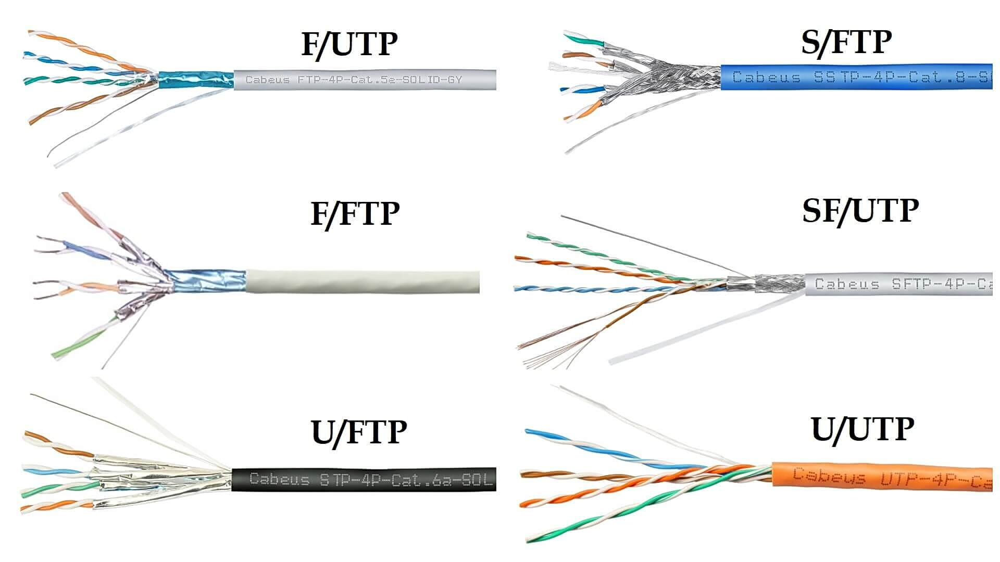

**Коаксиальный кабель** имеет другую конструкцию. В его центре располагается медный проводник, окружённый слоем диэлектрика. Далее находится металлический экран, который защищает сигнал от внешних электромагнитных воздействий, а снаружи кабель покрыт защитной оболочкой.

Для коаксиальных кабелей характерны волновые сопротивления 50 и 75 Ом. Выбор зависит от назначения системы: 50-омные кабели широко применяются в радиочастотном оборудовании, а 75-омные — в телевизионных и некоторых других системах передачи.

Коаксиальный кабель обеспечивает хорошее экранирование и может работать в широком диапазоне частот. Однако он менее удобен в монтаже, чем витая пара, и в современных локальных Ethernet-сетях в основном уступил ей и оптоволокну. При этом коаксиальные кабели продолжают использоваться в телевизионных сетях, радиочастотных системах и других специализированных областях.

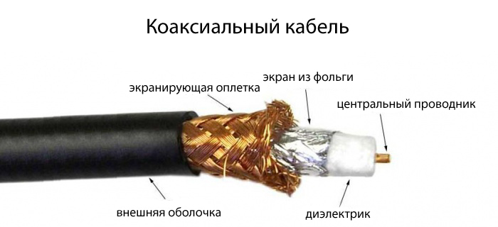

### Волоконно-оптические линии

В медных кабелях информация передаётся с помощью электрических сигналов. Другой способ организации проводной связи — использование света в качестве носителя информации. Для этого применяются **волоконно-оптические линии связи**.

Основным элементом такой линии является оптическое волокно, состоящее из центральной **сердцевины** и окружающей её **оболочки**. Показатель преломления сердцевины выше, чем у оболочки, благодаря чему свет может распространяться внутри волокна за счёт явления полного внутреннего отражения. При этом оптическое волокно представляет собой лишь один из элементов кабеля. Для защиты от механических повреждений, растяжения и воздействия влаги несколько волокон размещаются внутри защитной конструкции. В зависимости от типа кабеля его конструкция может включать следующие элементы:

- **Оптическое волокно** — непосредственно передаёт световой сигнал. Состоит из сердцевины и оболочки, а снаружи покрывается защитным полимерным покрытием.
- **Гидрофобный гель** — водоотталкивающий состав, которым заполняют внутренние полости кабеля или оптических модулей. Он препятствует распространению влаги вдоль кабеля при повреждении внешней оболочки.
- **Стеклонити** — армирующие элементы, которые повышают механическую прочность кабеля и помогают защищать волокна от растягивающих нагрузок.
- **Рипкорд (ripcord)** — специальный прочный шнур, расположенный под внешней оболочкой кабеля. При вытягивании он помогает разрезать оболочку вдоль кабеля и облегчает её снятие при монтаже.
- **Внешняя оболочка** — защитный слой, предохраняющий внутренние элементы кабеля от механических воздействий и окружающей среды.

В некоторых конструкциях дополнительно используются защитные трубки, броня и другие армирующие элементы. Конкретный набор компонентов зависит от назначения кабеля и условий его прокладки.

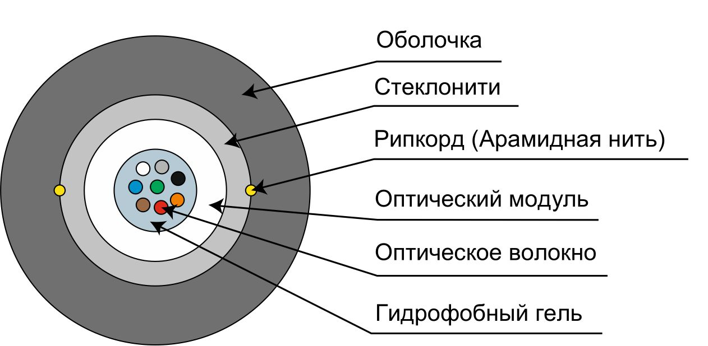

Оптическая связь обладает высокой пропускной способностью, низким затуханием и устойчивостью к электромагнитным помехам. Кроме того, оптическое волокно обеспечивает электрическую изоляцию между соединёнными устройствами и не создаёт электромагнитного излучения, характерного для электрических линий.

Для передачи данных оптический кабель подключается к оборудованию с помощью специальных оптических разъёмов. На стороне сетевого устройства обычно устанавливается **оптический модуль (трансивер)** — съёмное устройство, выполняющее преобразование электрических сигналов в оптические при передаче и оптических сигналов в электрические при приёме. Примерами таких модулей являются SFP, SFP+ и QSFP. Они различаются поддерживаемыми скоростями передачи, типами волокна и дальностью работы.

По режиму распространения света различают одномодовое и многомодовое волокно, которые основываются на понятии **оптическая мода** — это определённый способ распространения светового поля внутри оптического волокна. Она описывает пространственное распределение электромагнитного поля в поперечном сечении волокна. Волокно может поддерживать одну или несколько таких мод в зависимости от своих характеристик, в частности диаметра сердцевины и длины волны света.

**Одномодовое волокно** предназначено для распространения одной основной оптической моды. Свет распространяется преимущественно вдоль сердцевины волокна, поэтому модальная дисперсия практически отсутствует. Это позволяет передавать данные на большие расстояния и с высокой скоростью. В качестве источников света обычно используются лазеры.

**Многомодовое волокно** поддерживает распространение нескольких оптических мод. Они отличаются пространственным распределением светового поля и могут проходить различные пути внутри волокна. Из-за этого световые импульсы достигают приёмника в несколько различающиеся моменты времени. Такое растяжение импульса называется **модальной дисперсией**. Она ограничивает дальность и пропускную способность многомодовых линий. Несмотря на это ограничение, многомодовое волокно востребовано при организации связи на небольших расстояниях. Благодаря большему диаметру сердцевины оно предъявляет менее строгие требования к точности ввода света и позволяет использовать относительно недорогие оптические источники и трансиверы. Поэтому его часто применяют для соединения серверов, коммутаторов и другого оборудования внутри зданий и центров обработки данных, где не требуется передача сигнала на большие расстояния.

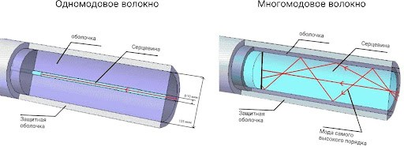

Для увеличения пропускной способности оптических линий применяется технология WDM. Она позволяет передавать несколько независимых оптических сигналов по одному волокну, используя разные длины волн света.

### Беспроводные линии связи

В проводных системах сигнал распространяется по физически проложенной линии. Однако во многих случаях прокладка кабеля затруднена или нецелесообразна. Для таких условий применяются **беспроводные линии связи**, в которых информация передаётся с помощью электромагнитных волн, распространяющихся в пространстве. К беспроводным системам относятся радиорелейная, спутниковая и сотовая связь, а также локальные беспроводные сети. Одним из наиболее распространённых примеров является **Wi-Fi**, работающий на основе семейства стандартов **IEEE 802.11**.

В отличие от кабельных линий, условия распространения радиосигнала сильно зависят от окружающей среды. На качество радиосвязи влияют частота, мощность передатчика, характеристики антенн, расстояние, рельеф местности и наличие препятствий. Сигнал может ослабляться, отражаться от различных объектов и поступать к приёмнику несколькими путями. Такое явление называется **многолучевым распространением** и может приводить к дополнительным искажениям передаваемых данных. Кроме того, радиочастотный спектр является ограниченным ресурсом. Поэтому его использование требует рационального распределения частот между различными системами связи, чтобы уменьшить взаимные помехи и обеспечить совместную работу оборудования.

Ещё одна особенность беспроводной связи связана с безопасностью. Поскольку радиосигнал может распространяться за пределы помещения или территории, его потенциально могут принимать посторонние устройства. Поэтому беспроводные сети используют механизмы аутентификации и шифрования, которые позволяют ограничить доступ к сети и защитить передаваемые данные.

Помимо защиты информации, при организации радиосвязи необходимо учитывать изменяющиеся условия распространения сигнала. Расстояние, препятствия и многолучевое распространение могут существенно влиять на качество радиоканала. Для повышения эффективности передачи в таких условиях применяются специальные методы модуляции и организации передачи данных. **Адаптивная модуляция** позволяет изменять параметры модуляции в зависимости от качества радиоканала. При хорошем качестве связи может использоваться более сложный режим, позволяющий передавать больше бит на один символ. При ухудшении условий система переходит к более устойчивому режиму, снижая скорость передачи, но повышая вероятность успешного приёма данных.

**OFDM (Orthogonal Frequency Division Multiplexing)** — метод передачи данных, при котором исходный поток разделяется на несколько частей, передаваемых одновременно по отдельным частотным поднесущим. Каждая поднесущая переносит свою часть данных. При этом поднесущие расположены настолько близко друг к другу, что их частотные диапазоны могут перекрываться. Это становится возможным благодаря их **ортогональности**: поднесущие подобраны таким образом, чтобы приёмник мог разделить их сигналы и выделить данные каждой из них без взаимных помех. Разделение общего потока между множеством поднесущих позволяет эффективно использовать доступную полосу частот. Кроме того, поскольку каждая поднесущая передаёт данные с меньшей скоростью, чем весь исходный поток, система становится менее чувствительной к некоторым искажениям, возникающим при многолучевом распространении радиоволн. OFDM применяется в современных беспроводных технологиях, включая Wi-Fi и сотовые сети.

### Сравнение физических сред передачи

Рассмотренные физические среды обладают различными характеристиками, поэтому выбор конкретного типа линии зависит от требований к дальности, скорости передачи, помехозащищённости, стоимости и условиям эксплуатации.

**Медные кабели** широко применяются для построения локальных сетей и подключения конечного оборудования. **Витая пара** отличается невысокой стоимостью, гибкостью и простотой монтажа, поэтому является распространённым решением для подключения компьютеров, IP-телефонов, точек доступа и другого сетевого оборудования. При этом неэкранированная витая пара чувствительна к внешним электромагнитным помехам, а её возможности ограничены допустимой длиной кабельного сегмента. Экранированные варианты обеспечивают дополнительную защиту от помех, но требуют правильного подключения и заземления экрана.

**Коаксиальный кабель** благодаря своей конструкции обеспечивает хорошую защиту от внешних электромагнитных помех. Он применяется, например, в системах кабельного телевидения, видеонаблюдения и некоторых радиочастотных трактах. Однако в современных локальных вычислительных сетях его во многом вытеснила витая пара.

**Волоконно-оптические линии** используются там, где требуются высокая пропускная способность, большая дальность передачи и устойчивость к электромагнитным помехам. Одномодовое волокно подходит для магистральных линий и соединений между удалёнными объектами, поскольку обеспечивает передачу данных на большие расстояния с низким затуханием. Многомодовое волокно применяется преимущественно для высокоскоростных соединений на небольших расстояниях, например внутри центров обработки данных. При этом оптические линии требуют специализированных трансиверов, разъёмов и оборудования для монтажа и обслуживания.

**Беспроводные линии** позволяют организовывать связь без прокладки кабеля непосредственно к каждому устройству. Это обеспечивает мобильность пользователей и упрощает подключение оборудования в местах, где прокладка кабеля затруднена или экономически нецелесообразна. Радиоканалы используются в локальных беспроводных сетях Wi-Fi, сотовой связи, радиорелейных и спутниковых системах. Их основные ограничения связаны с зависимостью качества связи от условий распространения радиоволн, воздействием помех и необходимостью рационального использования радиочастотного спектра.

| Среда передачи | Преимущества | Ограничения |
|---|---|---|
| Витая пара UTP | Низкая стоимость, простой монтаж, гибкость | Ограниченная дальность, чувствительность к внешним помехам |
| Экранированная витая пара | Дополнительная защита от электромагнитных помех | Более высокая стоимость, требования к правильному подключению и заземлению экрана |
| Коаксиальный кабель | Хорошее экранирование, возможность передачи широкополосных сигналов | Более сложный монтаж, ограниченная дальность по сравнению с оптоволокном |
| Одномодовое оптоволокно | Большая дальность, высокая пропускная способность, практически отсутствует модальная дисперсия | Необходимость специализированного оборудования и монтажа |
| Многомодовое оптоволокно | Подходит для коротких высокоскоростных соединений, позволяет использовать относительно недорогие оптические компоненты | Ограничение дальности из-за модальной дисперсии |
| Радиоканал | Мобильность, отсутствие необходимости прокладывать кабель к каждому устройству | Радиопомехи, ограниченность спектра, зависимость от условий распространения |

На практике разные физические среды часто используются совместно в пределах одной сети. Например, оптоволокно применяется для магистральных соединений между зданиями и сетевыми узлами, витая пара — для подключения конечных устройств внутри помещений, а радиоканалы — для организации беспроводного доступа. Такое сочетание позволяет использовать преимущества каждой среды в зависимости от конкретного участка сети.

Таким образом, физическая среда передачи определяет не только технические возможности линии связи, но и особенности построения, подключения и эксплуатации сетевой инфраструктуры.

## Блок 4. Многоканальные системы и методы разделения каналов

### Методы множественного доступа

В сетях связи одна физическая среда передачи может одновременно использоваться несколькими абонентами. Например, несколько мобильных устройств могут обмениваться данными через одну базовую станцию, а компьютеры в беспроводной сети — через одну точку доступа. Чтобы передачи разных абонентов не мешали друг другу, необходимо организовать разделение общего ресурса. Для этого применяются **методы множественного доступа (Multiple Access)**. В зависимости от способа разделения выделяют три основных метода: частотный, временной и кодовый.

**Частотное разделение (FDMA, Frequency Division Multiple Access)** основано на выделении каждому абоненту отдельного диапазона частот. Все абоненты могут передавать информацию одновременно, но используют разные участки общего спектра. На передающей стороне сигналы размещаются в отдельных частотных полосах. На принимающей стороне фильтры выделяют соответствующие диапазоны, позволяя разделить сигналы. Между соседними частотными полосами могут предусматриваться **защитные интервалы**. Они уменьшают взаимное влияние каналов и вероятность попадания значительной части энергии одного сигнала в соседний диапазон.

Преимущество частотного разделения заключается в возможности одновременной передачи данных несколькими абонентами. Однако доступный спектр ограничен, а защитные интервалы уменьшают его полезную часть. Кроме того, для разделения сигналов необходимы фильтры с соответствующими характеристиками.

**Временное разделение (TDMA, Time Division Multiple Access)** предполагает использование общей полосы частот несколькими абонентами, но в разные моменты времени. Каждому абоненту назначается определённый временной интервал, в течение которого он может передавать данные. Временные интервалы объединяются в циклы или **кадры**. Внутри каждого кадра каждому абоненту соответствует определённая временная позиция. Приёмное оборудование использует эту структуру для определения принадлежности полученных данных к конкретному абоненту. Для правильной работы временного разделения необходима **синхронизация** абонентов. Она позволяет определять границы кадров и временных интервалов, чтобы передачи не накладывались друг на друга.

Временное разделение также применяется в цифровых транспортных системах. В частности, на этом принципе основаны рассмотренные ранее иерархии PDH и SDH.

**Кодовое разделение (CDMA, Code Division Multiple Access)** основано на использовании различных кодовых последовательностей для разделения сигналов абонентов. Несколько абонентов могут одновременно использовать одну полосу частот и один временной ресурс, но их сигналы различаются специальными кодами. Каждому абоненту назначается определённая кодовая последовательность. Передаваемый сигнал обрабатывается с использованием этой последовательности, а принимающая сторона применяет соответствующий код для выделения нужного сигнала из общего потока. Для корректного разделения кодовые последовательности должны обладать подходящими свойствами взаимной корреляции. Это позволяет приёмнику выделять нужный сигнал на фоне других одновременно передаваемых сигналов.

Преимущество кодового разделения заключается в возможности совместного использования частотно-временного ресурса несколькими абонентами. Однако при увеличении количества активных абонентов возрастает уровень взаимных помех. Поэтому эффективность метода зависит от количества одновременно работающих абонентов, мощности принимаемых сигналов и свойств используемых кодовых последовательностей.

Основные методы множественного доступа можно сравнить следующим образом:

| Метод | Принцип разделения | Основное требование | Ограничение |
|---|---|---|---|
| FDMA | По частоте | Выделение отдельных частотных полос | Ограниченный спектр, защитные интервалы |
| TDMA | По времени | Синхронизация временных интервалов | Необходимость точного распределения времени |
| CDMA | По коду | Подходящие кодовые последовательности | Взаимные помехи между сигналами |

### Предоставление доступа к среде передачи

Разделение ресурса определяет, каким образом передачи разных абонентов могут сосуществовать в общей среде. Однако этого недостаточно: необходимо также установить, **как именно абоненты получают право начать передачу**. По способу предоставления доступа выделяют три основных подхода:

**Фиксированное закрепление ресурса** предполагает, что каждому абоненту заранее назначается определённая часть общего ресурса. Например, это может быть отдельная частотная полоса или временной интервал. Такой подход обеспечивает предсказуемое распределение ресурса и упрощает организацию передачи. Однако он может приводить к неэффективному использованию доступной ёмкости: если абонент не передаёт данные, закреплённый за ним ресурс остаётся незанятым другими абонентами.

При **динамическом выделении ресурса по запросу (DAMA, Demand Assigned Multiple Access)** ресурс предоставляется абоненту только тогда, когда возникает необходимость в передаче данных. Для этого абонент отправляет запрос, после чего система назначает ему доступный канал или временной интервал. После завершения обмена ресурс может быть освобождён и предоставлен другому абоненту. Такой подход позволяет эффективнее использовать ограниченные ресурсы при неравномерной нагрузке, когда не всем абонентам требуется передавать данные одновременно. Однако он требует дополнительных механизмов запроса, назначения и освобождения ресурсов.

**Случайный доступ** отличается тем, что абоненты самостоятельно начинают передачу, когда у них появляются данные. Предварительное закрепление ресурса или получение разрешения от центрального устройства не требуется. Если несколько абонентов начинают передавать данные одновременно, может возникнуть **коллизия** — ситуация, при которой сигналы мешают друг другу и данные не могут быть корректно приняты. Для организации случайного доступа применяются специальные протоколы. Они определяют момент начала передачи, способы проверки состояния среды и порядок повторных попыток при возникновении коллизий.

Одним из первых таких протоколов стал **ALOHA**. В нём абонент начинает передачу сразу после появления данных, не проверяя предварительно состояние общей среды. Если подтверждение успешного приёма не поступает, абонент предполагает, что передача могла завершиться неудачно, и повторяет попытку через случайный интервал времени.

Существует также **слотированный ALOHA (Slotted ALOHA)**, в котором начало передачи разрешено только в определённые моменты — на границах временных слотов. Это уменьшает вероятность пересечения передач, но требует синхронизации абонентов.

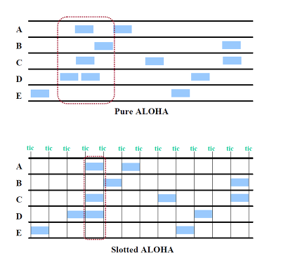

Следующим развитием этого подхода стал **CSMA (Carrier Sense Multiple Access)** — множественный доступ с контролем несущей. В отличие от ALOHA, перед началом передачи абонент сначала проверяет, свободна ли общая среда. Если она занята, передача откладывается. Если свободна, абонент может начать отправку данных. Проверка состояния среды снижает вероятность коллизий, однако не исключает их полностью: несколько абонентов могут практически одновременно обнаружить свободный канал и начать передачу. Для обработки таких ситуаций существуют две основные разновидности CSMA:

- **CSMA/CD (Collision Detection)** — обнаружение коллизий во время передачи. При обнаружении коллизии устройство прекращает передачу и повторяет попытку после случайной задержки. Применялся в классических разделяемых сетях Ethernet.
- **CSMA/CA (Collision Avoidance)** — предотвращение коллизий. Перед передачей устройство использует дополнительные интервалы ожидания и случайную задержку, чтобы снизить вероятность одновременного начала передачи. Применяется в беспроводных сетях Wi-Fi.
